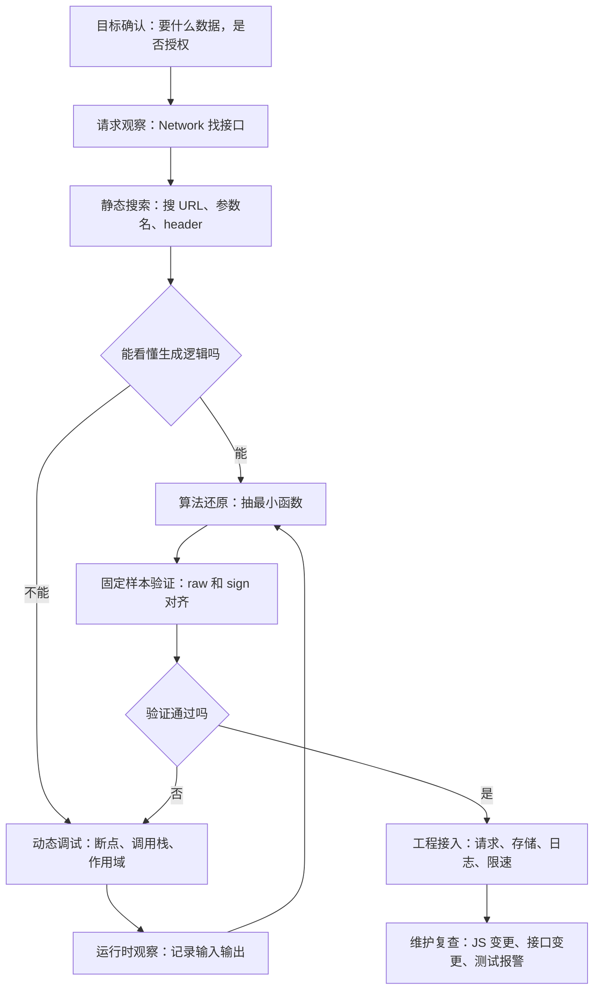

# 爬虫方向 JavaScript 逆向完整自学文档

这是一份面向小白的完整自学文档，不是学习计划，也不是知识点清单。它的目标不是让你照着学，而是让你一个人读的时候也能看懂：这一节为什么要学、遇到真实网页时怎么用、卡住以后怎么排查、学完以后怎么验证自己真的懂了。

这份文档的主题是：

> 当你做爬虫时，遇到网页里的 JS 动态请求、签名参数、加密字段、混淆代码，应该如何从零开始认识它、分析它、还原它，并把它接入合规的采集程序。

文档默认你具备一点点 Python 或爬虫基础，至少知道什么是 URL、网页、请求、响应。如果你完全没有编程基础，也可以读，但需要在第 0 课、第 1 课和第 2 课上多花时间，不要急着跳到签名、加密和混淆。

## 自学边界和重要提醒

这份文档只适用于这些场景：

- 分析公开网页如何加载公开数据。
- 分析自己的网站、公司授权的网站、练习站点或本地靶场。
- 复现自己有权限访问的数据接口。
- 学习 JavaScript、HTTP、加密签名和代码阅读能力。
- 建设稳定、低频、可维护、合规的数据采集流程。

这份文档不教这些内容：

- 绕过验证码。
- 绕过登录、会员、付费墙、权限校验。
- 绕过风控、指纹识别、反自动化检测。
- 获取或导出他人 cookie、token、密码、隐私数据。
- 对未授权系统进行批量请求、压力请求或探测。

如果一个接口必须登录、必须付费、必须人工验证，或者响应中包含个人隐私数据，你都应该先确认授权边界。JS 逆向不是“想拿什么就拿什么”的工具。它在爬虫学习中的合理位置，是帮助你理解网页请求是如何构造的，以及如何在授权范围内复现这些请求。

## 学习主线

整份文档围绕一条线展开：

```text
认识网页里的 JS
  -> 看懂请求是怎么发出来的
  -> 找到动态参数
  -> 判断参数是编码、哈希、签名还是加密
  -> 定位生成参数的 JS 代码
  -> 用断点确认中间值
  -> 抽出最小逻辑
  -> 在 Node.js 或 Python 中还原
  -> 处理混淆和 AST 自动化
  -> 接入稳定爬虫工程
```

你不需要一开始就理解整个前端项目。爬虫方向的 JS 逆向，不是把自己训练成前端工程师，也不是把整站源码全部看懂。真正要训练的是一种能力：

> 从一个请求出发，沿着参数和调用链，找到它产生的原因。

## 流程思维补充：不要一上来就钻代码

本节参考了 CSDN 文章《爬虫JS逆向技术深度解析：从入门到实战》的流程组织思路，并改写为适合自学的合规分析流程。原文链接：

https://blog.csdn.net/2301_79139273/article/details/152852455

这篇文章里最值得借鉴的，不是某一段代码，而是它强调的“逆向是一个生命周期”：先分析目标，再看代码，再动态调试，再还原算法，最后工程化使用。这个思路非常适合放在正式学习前面，因为小白最容易犯的错就是：

```text
一看到 sign，就马上搜 sign。
一看到加密，就马上问怎么解密。
一看到混淆，就马上找工具自动还原。
```

这三个动作都太急。真正稳定的 JS 逆向流程应该像查案一样，一步一步缩小范围。

### 自学时采用的合规逆向生命周期

我们把流程整理成下面这条线：

```text
目标确认
  -> 请求观察
  -> 静态搜索
  -> 动态调试
  -> 运行时观察
  -> 算法还原
  -> 固定样本验证
  -> 工程接入
  -> 维护复查
```

每一步要回答的问题都不一样。

#### 第一步：目标确认

先问：

```text
我要拿的到底是什么数据？
这个数据是否公开或已授权？
页面上哪个动作会触发这个数据？
是列表、详情、搜索结果，还是价格、库存、评论？
```

你可以这样理解：

```text
别一上来开 F12 就乱点。先把目标说清楚。
你要的是商品标题？价格？评论？分页列表？如果目标都没定，后面看到十几个请求一定会乱。
```

目标确认的输出：

```text
目标页面：
目标数据：
触发动作：
授权边界：
期望输出：
```

#### 第二步：请求观察

打开 Network，只看和目标动作同时出现的请求。

要记录：

```text
URL
method
query
headers
body
response
status
initiator
```

你可以这样理解：

```text
这一阶段不要急着看 JS。先看请求，因为请求是结果。
结果看清楚了，再倒着找原因。
```

请求观察的输出：

```text
目标接口是哪一个。
哪些参数固定。
哪些参数变化。
哪些字段可疑，比如 sign、token、timestamp、nonce。
```

#### 第三步：静态搜索

静态搜索就是不运行代码，先在 Sources 里搜。

可以搜：

```text
接口路径
参数名
header 名
sign
signature
encrypt
decrypt
timestamp
nonce
```

你可以这样理解：

```text
静态搜索像翻目录。你先看看书里有没有直接写答案。
能搜到接口路径，就别急着上复杂工具。
```

静态搜索的输出：

```text
关键 JS 文件。
疑似请求函数。
疑似签名函数。
疑似加密函数。
```

#### 第四步：动态调试

静态搜不到，或者搜到了但看不懂，就用断点。

常用断点：

```text
XHR/Fetch 断点
代码行断点
条件断点
事件断点
debugger 手动断点
```

动态调试要看：

```text
Call Stack 调用栈
Scope 作用域
局部变量
闭包变量
函数返回值
```

你可以这样理解：

```text
动态调试就像让演员停在舞台上。
停住以后不要慌，先看他手里拿了什么变量，再看他是从哪一层函数走过来的。
```

动态调试的输出：

```text
参数生成链路。
sign 的输入。
body 的原文。
timestamp 和 nonce 的来源。
```

#### 第五步：运行时观察

运行时观察不是为了“干预网站”，而是为了在授权练习场景里看清楚函数输入输出。

可以观察：

```text
某个函数被调用时传入了什么。
某个函数返回了什么。
某个对象在请求前被改成了什么。
```

你可以这样理解：

```text
我们不是为了乱改页面，也不是为了绕过什么东西。
我们只是把函数运行时的输入输出看清楚。
看清楚了，就能把逻辑写成自己的可测试函数。
```

这一阶段要谨慎。涉及登录、权限、验证码、风控、敏感 token 的地方，不做越界操作。

#### 第六步：算法还原

算法还原不是复制整份 JS，而是抽出最小逻辑。

要还原的通常是：

```text
参数排序
字符串拼接
编码
hash
HMAC
AES
RSA
nonce 生成
timestamp 生成
headers 组装
```

你可以这样理解：

```text
不要把 2MB 的前端包搬进你的爬虫。
我们只要那一小段能解释 sign 怎么来的逻辑。
```

算法还原的输出：

```text
一个纯函数。
固定输入。
固定输出。
一组测试样本。
```

#### 第七步：固定样本验证

固定样本是整个流程的安全绳。

你要保存：

```text
method
path
query
body
timestamp
nonce
raw string
sign
```

然后本地复现。

你可以这样理解：

```text
别用每次都会变的时间戳去排错。
先把时间戳和 nonce 固定住。浏览器里这次是多少，本地就写多少。
只有输入一样，输出才有资格对比。
```

验证通过的标准：

```text
浏览器 raw == 本地 raw
浏览器 sign == 本地 sign
浏览器请求结构 == 本地请求结构
```

#### 第八步：工程接入

还原成功只是第一步。真正能用还要工程化。

工程接入包括：

```text
签名模块
请求模块
解析模块
存储模块
日志模块
限速策略
错误重试
测试样本
合规说明
```

你可以这样理解：

```text
一个能跑一次的脚本，不叫工程。
能低频稳定运行，出错知道为什么，更新后知道哪里坏了，这才叫能交付。
```

#### 第九步：维护复查

JS 会更新，接口会变化，参数会调整。

维护时检查：

```text
关键 JS 文件是否变了。
接口路径是否变了。
参数名是否变了。
签名测试是否失败。
响应结构是否变了。
状态码是否异常。
```

你可以这样理解：

```text
逆向不是做完一次就结束。
它更像养一套小系统。你要知道它哪天坏了，为什么坏，怎么快速定位。
```

### 这篇 CSDN 流程能怎么转成自学方法

能直接吸收的部分：

- 把 JS 逆向看成完整生命周期。
- 工具要分层使用，不要所有问题都靠一个工具。
- 静态分析和动态调试要结合。
- 算法还原后要进入工程化。
- 安全与伦理要单独学。
- 性能和维护不能等到最后才想。

需要改写的部分：

- 原文里偏“突破、绕过”的表达，在这份文档里统一改成“授权范围内的分析、观察、复现”。
- Hook 技术只作为运行时观察思路，不作为规避检测的手段。
- 真实站点案例不直接照搬，这份文档中优先使用本地练习站点或明确授权场景。
- 加密相关内容不学“破解密钥”，只学识别算法、确认输入输出、在授权样本中复现。

### 工具分层思维

这篇文章还提到工具对比。我们把它改写成这份文档里的工具分层：

```text
第一层：Chrome DevTools
用途：看请求、打断点、看调用栈、看变量。
适合：所有初学者，必须先熟。

第二层：抓包工具
用途：观察 HTTP 流量、保存请求样本。
适合：接口很多、需要导出请求记录的场景。

第三层：Node.js
用途：运行 JS 逻辑、复现签名、验证算法。
适合：已经找到核心函数后的还原阶段。

第四层：AST 工具
用途：批量分析和转换混淆代码。
适合：代码量大、重复混淆模式明显的场景。

第五层：运行时观察工具
用途：观察函数输入输出和调用栈。
适合：静态代码难读，但能在授权环境中运行页面的场景。
```

你可以这样理解：

```text
工具不是越高级越好。
Network 能解决的，不要上 AST。
断点能看清的，不要急着写 Hook。
手工能确认的，不要一上来自动化。
```

### 三条还原路线：源码还原、补环境、远程复用

知乎这篇文章和前面的博客园内容大部分相同，但它开头有一个值得补进这份文档的框架：加密参数的还原不只有一种做法，常见路线大致分三类。

我们在这份文档里这样读：

```text
第一条：基于源码还原逻辑。
第二条：补齐运行环境，复用原函数。
第三条：远程复用浏览器里的函数。
```

这三条路线不是让大家一上来都学，而是让你知道：遇到不同难度的 JS，不要只有一种死办法。

#### 路线一：基于源码还原逻辑

这是这份文档最推荐小白先掌握的路线。

做法：

```text
找到签名函数
  -> 看清输入输出
  -> 抽出最小逻辑
  -> 用 Node.js 或 Python 重写
  -> 用固定样本验证
```

例子：

```js
function createSign(path, body, timestamp) {
  return sha256(path + body + timestamp + "demo");
}
```

你可以直接还原成自己的函数。

适合场景：

- 逻辑短。
- 依赖少。
- 没有太多浏览器环境变量。
- 输入输出清楚。

优点：

- 最干净。
- 最容易测试。
- 最容易维护。

缺点：

- 需要你真正看懂代码。
- 代码混淆严重时会比较费时间。

你可以这样理解：

```text
这条路线就是把题目看懂，然后自己做一遍。
它最笨，但也最稳。
```

#### 路线二：补环境模拟运行

有时候签名函数很长，里面依赖了浏览器对象：

```js
window
document
navigator
location
localStorage
```

如果你硬重写，成本很高。这时可以考虑在 Node.js 里补一部分环境，让原来的函数跑起来。

例子：

```js
global.window = {};
global.navigator = {
  userAgent: "Mozilla/5.0"
};
global.location = {
  pathname: "/api/search"
};
```

然后再运行目标函数。

适合场景：

- 核心函数能拿出来。
- 依赖的浏览器对象不多。
- 环境字段可以明确、合法地模拟。
- 目标是自学练习或授权项目。

优点：

- 不需要完全重写复杂函数。
- 对长代码比较省力。

缺点：

- 环境补多了会越来越乱。
- 不容易维护。
- 依赖真实浏览器行为的代码可能跑不起来。

你可以这样理解：

```text
补环境就像给演员搭一个简化舞台。
原来它要在浏览器大舞台上演，现在你在 Node 里搭几个必要道具，让它能把关键动作演完。
```

边界提醒：

```text
补环境是为了理解和复现授权范围内的参数生成逻辑，
不是为了伪造身份、规避权限或绕过安全检查。
```

#### 路线三：远程复用浏览器里的函数

有些复杂场景会提到 RPC 或远程调用：让浏览器继续运行原来的 JS，本地程序通过某种方式请求浏览器帮忙计算参数。

这份文档里只把它作为概念了解。

它的思路是：

```text
浏览器保持页面环境
  -> 本地程序发一个计算请求
  -> 浏览器调用页面里的函数
  -> 返回计算结果
```

适合拆解的场景：

- 本地练习站点。
- 自己的测试页面。
- 公司授权的调试环境。

不适合拿来实操的场景：

- 未授权真实网站。
- 登录态、验证码、风控相关页面。
- 需要长期挂浏览器才能工作的采集任务。

你可以这样理解：

```text
RPC 这条路听起来很省事，但它不是入门首选。
它更像临时借用浏览器的厨房，让浏览器帮你把 sign 炒出来。
但真正做工程，还是要尽量把菜谱看懂，能自己稳定复现。
```

#### 三条路线怎么选

```text
能源码还原，就优先源码还原。
源码太长但依赖清楚，可以尝试补环境。
补环境也很重，且只是授权调试，可以了解远程复用。
涉及权限、登录、验证码、风控，不继续推进。
```

小白阶段的推荐顺序：

```text
先学源码还原
  -> 再学少量补环境
  -> 最后只理解 RPC 思路
```

这能避免一上来就走偏。很多人刚入门就迷恋“远程调用”“Hook”“补环境大全”，结果 Network 还没看明白，raw string 还不会记录。顺序反了，后面一定会吃亏。

### 流程图

下面这张图是这份文档采用的流程，不是原帖原图，而是结合它的生命周期思路重新整理的版本：



这一节的最终目的，是你可以在开始写代码前先有脑内路线图。以后遇到任何 JS 逆向任务，都先问：

```text
我现在在哪一步？
这一步的输出是什么？
我是不是跳步了？
```

如果你能一直用这三个问题校准自己，逆向过程会稳很多。

## 通篇自学主线：用一个案例把整份文档串起来

前面的流程告诉你“先做什么、后做什么”，但自学文档不能只告诉你步骤。你真正需要的是：为什么这一步要做，做的时候脑子里应该想什么，做错了会发生什么，怎么从现象推到原因。

所以自学时建议始终围绕一个贯穿案例读：

```text
一个商品搜索页面。
用户输入关键词 shoes。
点击搜索按钮。
页面展示商品列表。
Network 里出现一个 /api/search 请求。
请求里有 timestamp、nonce、sign。
JS 文件经过一点压缩和简单混淆。
最后我们把 sign 还原成可测试函数，并接入低频采集脚本。
```

这个案例不需要复杂，越朴素越好。你要不断看到同一个东西如何在不同章节里被重新解释。

### 第一遍看：你看到的是页面，不是代码

刚开始不要打开代码。先看页面。

你可以这样理解：

```text
我们现在先不要管 JS，也不要管 sign。
你就把自己当成一个普通用户：我输入 shoes，点搜索，页面出现列表。
这时候你眼睛看到的是商品卡片，但浏览器背后一定做了事。
我们这份文档要学的，就是把“背后的事”一层一层翻出来。
```

这一步的作用，是把你从“我要学很多名词”拉回“我要解释一个现象”。自学时要尽量把所有概念都绑到现象上。否则你可能记住了 `fetch`、`headers`、`HMAC`，但不知道它们为什么出现。

接着问自己三个问题：

```text
商品列表是在 HTML 里吗？
如果不在 HTML 里，数据从哪里来？
谁负责把数据请求回来？
```

这三个问题自然引出 JavaScript。

### 第二遍看：JS 不是知识点，是页面背后的动作

不要直接说“JS 有变量、函数、对象、作用域”。这样你可能会觉得像背书。

先把它理解成动作：

```text
点击按钮以后，浏览器需要知道你搜的是什么。
所以 JS 要读取输入框。
读取完关键词以后，JS 要告诉服务器要第几页、每页多少条。
所以 JS 要拼参数。
服务器不想让参数被随便改。
所以 JS 可能要算一个 sign。
最后 JS 把这些东西放进 fetch 里发出去。
```

然后再把知识点放进去：

```text
关键词 shoes 是字符串。
page 和 size 是数字。
params 是对象。
Object.keys(params).sort() 是把参数名拿出来排序。
createSign(params) 是函数。
timestamp 来自 Date.now()。
点击按钮触发的是事件。
```

这样你学的不是孤立语法，而是“这些语法在页面动作里分别承担什么角色”。

### 第三遍看：Network 不是抓包窗口，是结果清单

小白打开 Network 很容易眼花，因为请求太多。不要一上来挨个点。

你可以这样理解：

```text
Network 不是让你把所有请求都看一遍。
它是浏览器给你的结果清单。
你刚刚点了搜索，所以我们只看这个动作之后新出现的 Fetch/XHR。
谁的 Response 里有商品数据，谁就是我们要找的接口。
```

这里要反复强调：

```text
先看结果，再倒推原因。
```

为什么？因为 JS 文件可能有几万行。如果先看代码，你很容易迷路。请求是已经发生的事实，接口 URL、参数、响应都是真实证据。

你可以亲手做一个小实验：

```text
清空 Network。
搜索 shoes。
记录新请求。
再清空 Network。
搜索 bags。
记录新请求。
对比两次请求。
```

对比以后问：

```text
哪些字段没变？
哪些字段变了？
变了的字段里，哪些是你能解释的？
哪些是你暂时解释不了的？
```

你能解释：

```text
keyword 变了，因为搜索词变了。
page 可能没变，因为都是第一页。
```

你暂时解释不了：

```text
timestamp 为什么变？
nonce 为什么变？
sign 为什么变？
```

这时签名分析就有了自学入口。它不是凭空冒出来的，而是你自己发现“有几个字段解释不了”。

### 第四遍看：sign 不是谜语，是一个函数的输出

你一看到 sign 可能会觉得它很神秘。先把神秘感拆掉。

你可以这样理解：

```text
sign 不要先理解成加密。
先把它理解成一个函数的输出。
既然是输出，就一定有输入。
我们要找的不是 sign 这串字符本身，而是它前面那一串输入。
```

然后写成最简单的形式：

```js
sign = someFunction(input);
```

再把真实情况展开：

```js
sign = hmacSha256(secret, raw);
raw = method + path + body + timestamp + nonce;
```

自学重点是：

```text
如果 raw 不一致，sign 一定不一致。
如果 raw 一致但 sign 不一致，再查算法、key、输出格式。
```

这比直接背 MD5、SHA、HMAC 更有效。因为你先建立了“输入输出”的思维，再去学算法名。

### 第五遍看：断点不是高级技巧，是暂停一下看证据

你容易把断点当成高手操作。要理解得朴素一点。

你可以这样理解：

```text
断点就是让浏览器暂停。
暂停以后，我们不猜了，直接看变量。
```

比如请求发出前停住，你看到：

```js
options = {
  method: "POST",
  headers: {
    "x-timestamp": "1710000000000",
    "x-nonce": "abc123",
    "x-sign": "70e8..."
  },
  body: "{\"keyword\":\"shoes\",\"page\":1}"
}
```

这时不要立刻继续跳。你要读出这些信息：

```text
method 是 POST。
body 是字符串，不是对象。
x-sign 已经算好了。
所以 sign 一定是在这一行之前生成的。
```

这就是“从现象倒推”的训练。

再看调用栈：

```text
fetch
request
search
click handler
```

你可以这样拆解：

```text
最下面是用户动作，最上面是最终请求。
我们要找 sign，就在 request 附近找。
```

这样调用栈就不是抽象概念，而是一条从点击到请求的路线。

### 第六遍看：还原不是复制代码，是用自己的话说清楚逻辑

你常见的误区是：找到一个函数以后，整段复制。

你要纠正这个习惯：

```text
复制不是还原。
还原的意思是：你能用自己的话说清楚它在干什么，并能用自己的代码做出同样输入输出。
```

比如原代码：

```js
const raw = Object.keys(params)
  .sort()
  .map(k => k + "=" + params[k])
  .join("&");
const sign = md5(raw + salt);
```

你要尝试翻译成中文：

```text
先取出所有参数名。
按字母顺序排好。
每个参数变成 key=value。
用 & 连接。
最后拼上 salt 做 MD5。
```

如果你能这样学出来，再写 Python 或 Node.js 就顺了。

### 第七遍看：固定样本让你不再乱猜

签名还原最容易卡在“我本地算的不一样”。这时你很容易乱试：

```text
是不是少了 header？
是不是算法错了？
是不是要 base64？
是不是要 urlencode？
```

要先把自己拉回固定样本。

你可以这样理解：

```text
我们现在不允许它变化。
timestamp 固定。
nonce 固定。
body 固定。
path 固定。
浏览器 raw 是什么，本地 raw 就必须是什么。
```

然后给自己做三列对比：

```text
字段        浏览器值        本地值
method      POST           POST
path        /api/search    /api/search
body        {"a":1}        {"a": 1}
timestamp   171...         171...
nonce       abc            abc
raw         ...            ...
sign        ...            ...
```

这里非常适合学“为什么 JSON 空格会影响 sign”。

```text
{"a":1}
{"a": 1}
```

这两个 JSON 表达的数据一样，但字符串不一样。签名看的是字符串，所以结果可能不同。

这就是自学文档应该补足的地方：不要只说“注意 JSON 字符串一致”，要看清自己会犯错的具体样子。

### 第八遍看：混淆不是新知识，是旧知识穿了外套

进入混淆前，先降低自己的恐惧。

可以这样理解：

```text
混淆代码不是外星语。
它只是把你认识的东西换了丑一点的名字。
Date.now 还是 Date.now。
JSON.stringify 还是 JSON.stringify。
headers["x-sign"] 还是设置请求头。
```

你可以先看一个很小的混淆例子：

```js
var _0xarr = ["now", "stringify", "x-sign"];
const t = Date[_0xarr[0]]();
const b = JSON[_0xarr[1]](data);
headers[_0xarr[2]] = sign;
```

逐行翻译：

```text
_0xarr[0] 是 now，所以 Date[_0xarr[0]]() 就是 Date.now()。
_0xarr[1] 是 stringify，所以 JSON[_0xarr[1]](data) 就是 JSON.stringify(data)。
_0xarr[2] 是 x-sign，所以 headers[_0xarr[2]] = sign 就是设置 x-sign。
```

你会发现：混淆并没有创造新逻辑，只是让旧逻辑难看。

### 第九遍看：AST 不是魔法，而是“结构化替换”

AST 很容易被学得很玄。不要一上来背一堆节点类型。

你可以这样理解：

```text
普通替换是看文字。
AST 是看代码结构。
我们不是把所有 arr[0] 字符串都替换掉，
而是只替换真正作为数组访问的 arr[0]。
```

举例：

```js
const text = "arr[0]";
const value = arr[0];
```

如果普通字符串替换，可能把字符串里的 `"arr[0]"` 也改了。AST 可以只改第二行。

这就是 AST 的意义：不是更酷，而是更稳。

### 第十遍看：工程化不是收尾，是从第一天就要埋伏笔

很多资料到最后才讲工程化，你可能会觉得那是附加内容。这里要从第一节就埋伏笔：

```text
你今天记录的请求样本，后面会变成测试用例。
你今天写的 raw string，后面会变成签名模块的断言。
你今天记录的 JS 文件地址，后面会用于变更检测。
你今天写的分析报告，后面会变成维护文档。
```

你要理解：记录不是麻烦，是为了后面少崩溃。

### 这条主线怎么嵌入后面的每一课

后面每一课都要回到这个案例。

```text
第 0 课：用这个案例解释 JS 为什么要学。
第 1 课：用这个案例解释数据为什么不在 HTML 里。
第 2 课：用这个案例解释变量、对象、函数、作用域。
第 3 课：用这个案例找 /api/search。
第 4 课：用这个案例从 /api/search 反查 request。
第 5 课：用这个案例判断 sign 是哈希还是 HMAC。
第 6 课：用这个案例还原 sign。
第 7 课：把 body 加密作为案例升级。
第 8 课：把 createSign 混淆后再还原。
第 9 课：用 AST 批量替换字符串数组。
第 10 课：把还原结果接入采集脚本。
第 11 课：整理完整自学案例报告。
```

这就是“自学文档”和“操作文档”的区别。操作文档告诉你：

```text
打开 Network，找到请求，搜索参数，打断点。
```

自学文档还要让你明白：

```text
为什么先看 Network。
为什么请求是结果。
为什么要倒推代码。
为什么 sign 要先找输入。
为什么固定样本能减少猜测。
为什么还原不是复制。
为什么工程化从第一份记录开始。
```

后面的内容都应该按这个标准去读和学。

## 第 0 课：JS 逆向前置自学课

本课参考了博客园文章《最全的JS逆向-一篇带你学完爬虫逆向所有知识点》中“逆向基础”部分的知识组织方式，并结合这份文档目标改写成更口语、更适合自学的表达。原帖链接：

https://www.cnblogs.com/yoyo1216/p/19022581

注意：这里不是搬运原文，而是把它提到的 JS 基础方向转成更适合小白开课前理解的理解方式。原帖的前置基础重点包括：语法基础、作用域、窗口对象属性和事件。我们会按“为什么要学、逆向时在哪里用、怎么快速上手”的方式学。

这一课不要只读。你要真的打开浏览器做一遍。读懂 JS 的第一步不是背概念，而是亲眼看到：

```text
我输入了一行 JS。
浏览器马上算出了结果。
我点了一下按钮。
Network 里真的多了一个请求。
我打了一个断点。
代码真的停在了某一行。
```

如果你以前没有写过 JS，这一课的正确学习方式是：

```text
先照着操作，不急着完全理解。
看到结果后，再回头解释为什么。
解释不出来，就改一个变量、删一个字段、换一个值，再观察结果怎么变。
```

### 0.0 本课准备：先搭一个最小练习页面

不要一上来就拿真实网站练。真实网站代码太多、压缩太狠、变量名太乱，小白很容易把“看不懂真实项目”误会成“自己学不会 JS”。先用一个自己能控制的小页面练手。

在电脑上新建一个文件，名字可以叫：

```text
js_reverse_demo.html
```

把下面这段代码放进去，然后用 Chrome 打开这个 HTML 文件：

```html
<!doctype html>
<html>
<head>
  <meta charset="utf-8">
  <title>JS Reverse Demo</title>
</head>
<body>
  <input id="keyword" value="shoes">
  <button id="search">搜索</button>
  <pre id="output"></pre>

  <script>
    const appId = "demo-app";
    const salt = "demo-salt";

    function simpleHash(text) {
      let hash = 0;
      for (let i = 0; i < text.length; i++) {
        hash = (hash * 31 + text.charCodeAt(i)) >>> 0;
      }
      return hash.toString(16);
    }

    function buildParams(keyword) {
      return {
        keyword: keyword,
        page: 1,
        size: 20,
        timestamp: Date.now()
      };
    }

    function createSign(params) {
      const raw = Object.keys(params)
        .sort()
        .map(key => key + "=" + params[key])
        .join("&");

      return {
        raw: raw,
        sign: simpleHash(raw + salt)
      };
    }

    function search(keyword) {
      const params = buildParams(keyword);
      const signInfo = createSign(params);
      const headers = {
        "x-app-id": appId,
        "x-sign": signInfo.sign
      };

      const result = {
        url: "/api/search",
        method: "POST",
        params: params,
        headers: headers,
        raw: signInfo.raw
      };

      document.querySelector("#output").textContent = JSON.stringify(result, null, 2);

      fetch("https://httpbin.org/post", {
        method: "POST",
        headers: {
          "content-type": "application/json",
          "x-app-id": appId,
          "x-sign": signInfo.sign
        },
        body: JSON.stringify(params)
      });
    }

    document.querySelector("#search").addEventListener("click", function() {
      const keyword = document.querySelector("#keyword").value;
      search(keyword);
    });
  </script>
</body>
</html>
```

如果你不方便访问 `https://httpbin.org/post`，也没关系。这个页面仍然能在页面上显示参数、raw string 和 sign。Network 请求可能失败，但不影响你练 JS 链路。学习重点不是请求成功，而是看清：

```text
input 里的 keyword 怎么被 JS 读走。
params 怎么被组装。
raw string 怎么拼出来。
sign 怎么被计算出来。
headers 怎么被设置。
click 事件怎么触发 search。
```

接下来所有前置知识，都围绕这个小页面练。

### 0.1 开场：学 JS 不是为了写前端，而是为了看懂网页怎么干活

先把心态放轻松。我们学 JS 逆向前的 JS 基础，不是让你从今天开始转行前端，也不是让你先把 Vue、React、Webpack 全部学完。我们只解决一个很具体的问题：

```text
浏览器里那段 JS，到底在什么时候、拿了什么东西、怎么算出了什么参数、最后怎么把请求发出去。
```

你做爬虫时最常见的卡点是：

```text
Python 请求页面，拿不到数据。
浏览器里能看到数据，但 HTML 里没有。
Network 里有接口，但参数里有 sign、token、timestamp。
JS 文件里能搜到 sign，但代码看起来像一团麻。
```

所以这节课的目标不是“精通 JS”，而是让你建立这几个直觉：

- JS 是浏览器里真正干活的脚本。
- 数据类型决定了参数长什么样。
- 函数决定了参数是怎么被加工出来的。
- 作用域决定了变量藏在哪里。
- window、document、navigator、location 这些浏览器对象经常参与环境判断或参数构造。
- 事件决定了“点击搜索、滚动页面、输入关键词”之后哪些代码会执行。

你只要先把这些东西认识清楚，后面看签名、加密、混淆、AST 才不会像看天书。

### 0.2 JS 在逆向里从哪里开始用到

先看一个最常见的页面动作。

```text
你输入关键词 -> 点击搜索 -> 页面出现列表
```

表面上你只是点了一个按钮。实际上浏览器里可能发生了这些事：

```text
按钮 click 事件触发
  -> JS 读取输入框的关键词
  -> JS 拼出请求参数
  -> JS 生成 timestamp
  -> JS 生成 nonce
  -> JS 根据参数算 sign
  -> JS 调用 fetch 或 XMLHttpRequest
  -> 后端返回 JSON
  -> JS 把 JSON 渲染到页面
```

所以 JS 逆向前的学习顺序应该是：

```text
先学变量和数据类型
  -> 再学对象、数组和函数
  -> 再学作用域
  -> 再学浏览器对象
  -> 再学事件
  -> 最后把它们串到请求里
```

别一开始就问“怎么还原 AES”。如果你连 `body` 是字符串还是对象都没分清，AES 一定还原不稳。

### 0.3 第一件事：认识数据类型

JS 里的数据类型，你不用背定义，你就记住它们在请求里会变成什么。

这一小节先用 Chrome Console 练。操作步骤：

```text
1. 用 Chrome 打开刚才的 js_reverse_demo.html。
2. 按 F12 打开开发者工具。
3. 切到 Console 面板。
4. 复制下面的代码，一段一段粘进去。
5. 每粘一段，按 Enter，看浏览器输出什么。
```

Console 可以理解成“浏览器里的 JS 草稿纸”。你在里面输入 JS，浏览器会直接执行并把结果显示出来。逆向时你经常会用 Console 做小实验，比如验证时间戳、测试字符串拼接、调用页面里的函数。

#### 字符串 string

字符串就是一段文本。逆向里最常见。

```js
const path = "/api/search";
const keyword = "shoes";
const headerName = "x-sign";
```

在 Console 里输入：

```js
const keyword = "shoes";
const path = "/api/search";
path + "?keyword=" + keyword;
```

你应该看到类似结果：

```text
"/api/search?keyword=shoes"
```

这一步要理解的是：很多请求参数不是凭空出现的，就是一段段字符串拼出来的。你以后看到：

```js
url = "/api/search" + "?keyword=" + keyword
```

就不要把它当复杂代码，它只是在拼 URL。

它会出现在：

- URL。
- query 参数。
- header 名。
- header 值。
- body 字符串。
- 签名前的 raw string。

逆向时看到字符串，先问：

```text
它是固定写死的？
还是用户输入的？
还是从接口返回的？
还是由几个变量拼出来的？
```

#### 数字 number

数字常见于页码、数量、时间戳。

```js
const page = 1;
const size = 20;
const timestamp = Date.now();
```

在 Console 里输入：

```js
Date.now()
```

你会看到一个 13 位左右的数字，比如：

```text
1760000000000
```

再输入：

```js
Math.floor(Date.now() / 1000)
```

你会看到一个 10 位左右的数字。把这两个结果放在一起看：

```text
Date.now() 是毫秒级时间戳。
Math.floor(Date.now() / 1000) 是秒级时间戳。
```

注意：时间戳尤其重要。

```text
10 位：通常是秒级时间戳
13 位：通常是毫秒级时间戳
```

很多 sign 失败，就是因为你把 13 位毫秒时间戳写成了 10 位秒时间戳。

#### 布尔 boolean

布尔值就是 `true` 或 `false`。

```js
const isLogin = true;
const needSign = true;
```

它常见于开关：

- 是否登录。
- 是否加密。
- 是否启用某个功能。
- 是否走缓存。

#### undefined 和 null

`undefined` 表示没定义或没传值，`null` 表示故意给了一个空值。

```js
let token;
const user = null;
```

逆向里特别要注意：参数如果是 `undefined`，有些代码会跳过这个字段；如果是 `null`，可能会把它放进 JSON。

```js
JSON.stringify({ a: undefined, b: null })
```

结果是：

```json
{"b":null}
```

你要亲手在 Console 里试一次：

```js
JSON.stringify({ a: undefined, b: null, c: "shoes" })
```

观察结果：

```json
{"b":null,"c":"shoes"}
```

这里非常关键：`a` 不见了。不是显示成空字符串，也不是显示成 `undefined`，而是整个字段被 JSON 忽略了。以后你还原签名时，如果浏览器 raw string 里没有某个字段，而你本地加上了这个字段，sign 就可能不同。

如果签名依赖 JSON 字符串，这种差异会直接影响 sign。

这一小节的自检问题：

```text
1. "1" 和 1 一样吗？
2. Date.now() 为什么通常是 13 位？
3. undefined 放进 JSON 后会发生什么？
4. null 和 undefined 在请求 body 里可能造成什么差异？
```

你不需要背术语，但要能用自己的话说出来：

```text
字符串负责拼内容。
数字经常负责页码、数量、时间戳。
undefined 可能让字段消失。
null 可能作为空值被真的发出去。
```

### 0.4 第二件事：引用类型就是“装东西的盒子”

JS 里的对象、数组、函数都可以理解成引用类型。你可以这么理解：

```text
基础类型像一张纸条，值就写在纸条上。
引用类型像一个箱子，变量手里拿的是箱子的地址。
```

#### 对象 object

对象就是键值对。

```js
const params = {
  keyword: "shoes",
  page: 1,
  size: 20
};
```

在 Console 里输入：

```js
const params = {
  keyword: "shoes",
  page: 1,
  size: 20
};

params.keyword
params["keyword"]
JSON.stringify(params)
```

你会看到：

```text
"shoes"
"shoes"
"{\"keyword\":\"shoes\",\"page\":1,\"size\":20}"
```

这里要看懂三件事：

```text
params.keyword 是取对象字段。
params["keyword"] 也是取对象字段。
JSON.stringify(params) 是把对象变成 JSON 字符串。
```

逆向里经常会卡在“对象”和“字符串”没分清：

```js
const bodyObj = { keyword: "shoes", page: 1 };
const bodyText = JSON.stringify(bodyObj);
```

`bodyObj` 是对象，`bodyText` 是字符串。签名时到底用对象还是字符串，一定要看浏览器原始代码。

爬虫逆向里，对象最常见的身份是：

- query 参数对象。
- body 数据对象。
- headers 对象。
- axios config 对象。
- 返回的 JSON 对象。

读对象时要问：

```text
这个对象里有哪些字段？
字段是固定的还是动态的？
这个对象最后是变成 query、body，还是 headers？
```

#### 数组 array

数组是一排东西。

```js
const keys = ["keyword", "page", "size"];
```

数组在签名里很常见，因为很多签名都要排序：

```js
const raw = Object.keys(params)
  .sort()
  .map(key => key + "=" + params[key])
  .join("&");
```

不要整段硬看，把这段拆开做。先在 Console 里输入：

```js
Object.keys(params)
```

你会看到：

```text
["keyword", "page", "size"]
```

再输入：

```js
Object.keys(params).sort()
```

再输入：

```js
Object.keys(params).sort().map(key => key + "=" + params[key])
```

最后输入：

```js
Object.keys(params).sort().map(key => key + "=" + params[key]).join("&")
```

最后结果应该类似：

```text
"keyword=shoes&page=1&size=20"
```

这才是正确学法：不要只看最终代码，要把链式调用切成几段，逐段看每一步输出。你以后遇到真实签名，也按这个方法拆：

```text
Object.keys(params)：拿到所有参数名
sort()：排序
map(...)：每个参数变成 key=value
join("&")：用 & 拼成字符串
```

这就是很多签名的原材料。

#### 函数 function

函数是 JS 逆向的核心。因为参数通常不是凭空出现的，而是函数算出来的。

```js
function createSign(params) {
  const raw = Object.keys(params).sort().join("&");
  return md5(raw);
}
```

现在回到你的练习页面。刷新页面后，在 Console 里输入：

```js
buildParams("bags")
```

你应该看到一个对象：

```text
{keyword: "bags", page: 1, size: 20, timestamp: 176...}
```

再输入：

```js
createSign(buildParams("bags"))
```

你会看到类似：

```text
{raw: "keyword=bags&page=1&size=20&timestamp=176...", sign: "..."}
```

这一步非常重要：你不是只看代码，而是在调用页面里真实存在的函数。真实逆向时，如果某个函数没有被保护在局部作用域里，你也可以在 Console 里直接调用它来观察输入输出。

看函数时只问五件事：

```text
它叫什么？
它接收什么？
它内部用了什么外部变量？
它返回什么？
返回值被谁拿走了？
```

如果你能回答这五个问题，很多 JS 就不吓人了。

### 0.5 第三件事：语句和运算符，别背，要知道逆向里怎么用

原帖里把语句标识符、算术运算符、比较运算符也放进了语法基础。我们这里用逆向场景学。

这一节继续用 Console 做小实验。重点不是背 `if`、`for`、`switch` 的定义，而是看懂它们怎么改变请求参数和签名流程。

#### if 判断

```js
if (token) {
  headers["authorization"] = token;
}
```

意思是：有 token 才加请求头。

逆向时要问：

```text
token 从哪里来？
没有 token 会不会走另一条逻辑？
```

在 Console 里输入：

```js
let token = "";
let headers = {};

if (token) {
  headers["authorization"] = token;
}

headers
```

你会看到：

```text
{}
```

再输入：

```js
token = "abc123";
headers = {};

if (token) {
  headers["authorization"] = token;
}

headers
```

你会看到：

```text
{authorization: "abc123"}
```

这说明同一段代码，因为 `token` 有没有值，会走出不同结果。逆向时如果浏览器有某个 header，而你本地没有，可能不是你没复制 header，而是你没有满足某个 `if` 条件。

#### for 循环

```js
for (const key of Object.keys(params)) {
  raw += key + "=" + params[key];
}
```

签名里经常循环参数。

在 Console 里输入：

```js
const loopParams = { keyword: "shoes", page: 1, size: 20 };
let rawText = "";

for (const key of Object.keys(loopParams)) {
  rawText += key + "=" + loopParams[key] + "&";
}

rawText
```

你会看到：

```text
"keyword=shoes&page=1&size=20&"
```

这里要理解：循环就是“把同样的加工动作，对每个字段做一遍”。签名里的 raw string 很多都是这样循环出来的。

#### switch 分支

```js
switch (type) {
  case "aes":
    return encryptAES(data);
  case "rsa":
    return encryptRSA(data);
}
```

看到 switch，要看当前 type 是什么。不要把所有分支都读一遍，先确认运行时走哪条。

在 Console 里输入：

```js
function chooseEncrypt(type, data) {
  switch (type) {
    case "aes":
      return "use aes for " + data;
    case "rsa":
      return "use rsa for " + data;
    default:
      return "no encrypt";
  }
}

chooseEncrypt("aes", "body")
chooseEncrypt("rsa", "body")
chooseEncrypt("plain", "body")
```

观察三次输出，你会明白：读 `switch` 时先看运行时的 `type`，不要把每条分支都当成当前请求会执行。

#### 三元表达式

```js
const method = data ? "POST" : "GET";
```

意思是：有 data 就 POST，没有 data 就 GET。

在 Console 里输入：

```js
const data1 = { keyword: "shoes" };
const data2 = null;

data1 ? "POST" : "GET"
data2 ? "POST" : "GET"
```

你会看到一个是 `POST`，一个是 `GET`。以后看到 `条件 ? A : B`，就把它翻译成：

```text
如果条件成立，用 A。
否则用 B。
```

#### 逗号表达式

混淆代码里常见：

```js
return a = Date.now(), b = md5(a + salt), b;
```

可以理解成：

```js
a = Date.now();
b = md5(a + salt);
return b;
```

小白看到逗号表达式容易懵，但它本质就是把多步压成一行。

#### 位运算

原帖也提醒了 JS 的位运算会按 32 位整数处理。逆向里你不一定天天用，但遇到 hash、随机数、某些混淆算法时会看到：

```js
x = x << 5;
x = x >>> 0;
x = x ^ y;
```

你先记住：

```text
<< 左移
>> 有符号右移
>>> 无符号右移
^ 异或
& 按位与
| 按位或
```

初学阶段不需要手算复杂位运算，但要知道它们会影响最终 hash 或编码结果。

你可以在 Console 里试一个最小例子：

```js
5 ^ 3
5 << 1
5 >>> 0
```

现在不要求你推导二进制，只要知道：这些符号不是普通加减乘除，它们通常出现在 hash、编码、混淆或随机数逻辑里。看到它们时，不要随手删掉。

### 0.6 第四件事：函数是头等公民，签名逻辑经常被当成变量传来传去

JavaScript 里的函数可以像变量一样使用。

```js
function md5Sign(text) {
  return md5(text);
}

const signer = md5Sign;
const sign = signer("hello");
```

也可以直接写匿名函数：

```js
const signer = function(text) {
  return md5(text);
};
```

也可以写箭头函数：

```js
const signer = text => md5(text);
```

这里要提醒自己：别只搜 `function createSign`。真实代码里签名函数可能长这样：

```js
const s = e => md5(e + salt);
```

也可能被作为参数传进去：

```js
request.use(config => {
  config.headers["x-sign"] = signer(config);
  return config;
});
```

所以你要看函数的作用，不要只看函数名。

在 Console 里做一个小实验：

```js
function makeTextSign(text) {
  return "sign:" + text;
}

const signer = makeTextSign;
signer("hello")
```

你会看到：

```text
"sign:hello"
```

这里的重点是：`signer` 不是字符串，也不是对象，它是一个函数变量。再试一个箭头函数：

```js
const s = text => "sign:" + text;
s("world")
```

你会看到：

```text
"sign:world"
```

所以真实代码里如果你搜不到 `function createSign`，不要慌。签名函数可能藏在变量里，可能是箭头函数，也可能作为参数传给请求封装函数。

### 0.7 函数参数可以多传、少传，这会影响你读代码

JS 的函数参数很宽松。

```js
function add(a, b) {
  return a + b;
}

add(1, 2, 3);
add(1);
```

多传的参数，函数可以不管。少传的参数，会变成 `undefined`。

在 Console 里输入：

```js
function showArgs(a, b, c) {
  return {
    a: a,
    b: b,
    c: c
  };
}

showArgs(1, 2, 3)
showArgs(1, 2)
showArgs(1, 2, 3, 4, 5)
```

你要观察：

```text
少传时，c 是 undefined。
多传时，前面三个参数照常接收，多出来的参数默认不影响结果。
```

逆向时这点很重要。比如：

```js
function createSign(path, body, timestamp) {
  return md5(path + body + timestamp);
}
```

如果调用时少传了：

```js
createSign("/api/list", "{}");
```

那么 `timestamp` 是 `undefined`，最后拼出来可能是：

```text
/api/list{}undefined
```

有些签名失败，就是因为你本地复现时少传了一个参数。

再做一次更贴近签名的实验：

```js
function demoSign(path, body, timestamp) {
  return path + "|" + body + "|" + timestamp;
}

demoSign("/api/list", "{}")
demoSign("/api/list", "{}", 1700000000000)
```

比较两次结果，你会看到少传参数时字符串里出现了 `undefined`。这就是为什么还原签名时要把函数调用参数一个个对齐。

### 0.8 return：函数看到 return 就结束

```js
function getToken() {
  if (!localStorage.getItem("token")) {
    return "";
  }
  return localStorage.getItem("token");
}
```

函数执行到 `return` 就结束。读逆向代码时要看清楚哪条分支先 return。

在 Console 里输入：

```js
function checkToken(token) {
  if (!token) {
    return "no token";
  }
  return "has token:" + token;
}

checkToken("")
checkToken("abc123")
```

你会看到两个不同结果。这里要注意：当 `token` 为空时，函数在第一个 `return` 就结束了，后面的 `return "has token"` 不会执行。

如果函数没有写 return，默认返回 `undefined`。

```js
function test() {
  const a = 1;
}

const result = test(); // undefined
```

这在调试时很常见：你以为函数算出了 sign，实际它只是修改了某个对象，没有返回值。

```js
function addSign(config) {
  config.headers["x-sign"] = createSign(config);
}
```

这种函数的重点不是 return，而是副作用：它改了 `config.headers`。

在 Console 里输入：

```js
function addDemoSign(config) {
  config.headers["x-sign"] = "abc123";
}

const config = { headers: {} };
const result = addDemoSign(config);

result
config
```

你会看到：

```text
result 是 undefined
config.headers 里多了 x-sign
```

这就是副作用。真实逆向里有些函数不返回 sign，但它会把 sign 塞进 headers、params 或 config。你不能只盯着 return，还要看它有没有改对象。

### 0.9 第五件事：作用域，变量到底藏在哪里

原帖提到 JS 有全局作用域、函数作用域和块级作用域。我们用逆向话术学。

作用域就是：

```text
这个变量在哪些地方能被看见。
```

这一小节也要在 Console 里做。作用域靠读定义很难懂，靠“哪里能访问、哪里报错”最容易懂。

#### 全局作用域

```js
var appId = "demo-app";

function createSign(text) {
  return md5(text + appId);
}
```

`appId` 在函数外面，函数里面也能用。

在练习页面的 Console 里输入：

```js
appId
```

你应该能看到：

```text
"demo-app"
```

再输入：

```js
search("phone")
```

页面会出现一段结果，其中 headers 里有：

```json
{
  "x-app-id": "demo-app",
  "x-sign": "..."
}
```

这说明 `search` 函数内部能用到外面的 `appId`。真实逆向里，你经常会看到函数内部突然用了一个变量，但这个变量不是参数传进来的。这个时候不要急着说“缺变量”，要往外层找。

逆向时看到函数内部用了一个没定义的变量，不要马上说缺失。它可能在外层或全局。

#### 函数作用域

```js
function request() {
  const secret = "demo";
  return md5(secret);
}

console.log(secret); // 报错
```

`secret` 只能在函数内部访问。

在 Console 里输入：

```js
function testScope() {
  const secret = "inside";
  return secret;
}

testScope()
```

你会看到：

```text
"inside"
```

再输入：

```js
secret
```

你会看到报错，类似：

```text
ReferenceError: secret is not defined
```

这个报错不是坏事，它正好说明：`secret` 藏在函数内部，外面看不到。真实逆向里如果某个 `secret` 在函数内部定义，你本地复现时不能只复制最后一行，需要把它的来源一起拿出来。

#### 块级作用域

```js
if (true) {
  let timestamp = Date.now();
}

console.log(timestamp); // 报错
```

`let` 和 `const` 声明的变量有块级作用域。

在 Console 里试：

```js
if (true) {
  let blockValue = "only inside block";
  blockValue
}
```

这一段内部能看到值。然后单独输入：

```js
blockValue
```

外面会报错。以后你在断点暂停时，Scope 面板里会看到不同层级的变量，这就是为什么有些变量当前行能看见，换个地方就看不见。

#### 闭包

闭包是逆向里非常关键的概念。

```js
function createSigner(secret) {
  return function(path) {
    return md5(path + secret);
  };
}

const sign = createSigner("demo-secret");
```

你调用 `sign("/api/list")` 时，看起来只传了 path，但它还能用 `secret`。因为 `secret` 被闭包记住了。

你可以这样理解：

```text
闭包就像函数背了一个小书包。
外面看它只拿了 path，实际上书包里还装着 secret。
```

在 Console 里亲手试一次：

```js
function createSigner(secret) {
  return function(path) {
    return path + "|" + secret;
  };
}

const signerA = createSigner("aaa");
const signerB = createSigner("bbb");

signerA("/api/search")
signerB("/api/search")
```

你会看到两个不同结果：

```text
"/api/search|aaa"
"/api/search|bbb"
```

它们调用时都只传了 `"/api/search"`，但结果不同，因为两个函数各自背着不同的 `secret`。这就是闭包。真实逆向中，如果你只看到：

```js
signer("/api/search")
```

不要以为签名只依赖 path。`signer` 可能早就在外层记住了 appId、secret、salt、版本号。

逆向时如果你发现函数参数不够，但它还能算出 sign，就要检查闭包和外层变量。

### 0.10 第六件事：window 对象，浏览器环境的大总管

原帖专门提到 window 的常见属性和方法。为什么 JS 逆向要认识 window？因为很多网页代码不是只用普通 JS，它还会用浏览器环境。

这一节的操作方式：

```text
1. 仍然打开练习页面。
2. 打开 Console。
3. 输入下面这些浏览器对象。
4. 观察它们返回的是页面信息、浏览器信息，还是地址信息。
```

#### window

`window` 表示当前浏览器窗口。

```js
window.location.href
window.navigator.userAgent
window.document
```

很多浏览器变量都挂在 window 上。

在 Console 输入：

```js
window === globalThis
```

通常会看到：

```text
true
```

再输入：

```js
window.appId
```

如果你用的是上面的练习页面，因为 `appId` 是 `const` 声明，通常不会直接挂到 `window` 上。这个现象也很重要：不是所有页面变量都能通过 `window.xxx` 拿到。真实网站用模块化打包后，很多函数和变量也不会暴露在 `window` 上，所以你需要靠断点和调用栈找。

#### document

`document` 表示当前 HTML 文档。

```js
document.querySelector("#keyword").value
```

搜索请求里，关键词可能来自输入框。

在练习页面输入框里把 `shoes` 改成 `phone`。然后在 Console 输入：

```js
document.querySelector("#keyword").value
```

你应该看到：

```text
"phone"
```

这说明 JS 真的可以从页面输入框读取值。你再输入：

```js
document.querySelector("#keyword").value = "bag"
document.querySelector("#keyword").value
```

你会看到输入框也被改了。逆向里如果关键词来自输入框，就要顺着 `document.querySelector(...).value` 找到它怎么进入 params。

```js
const keyword = document.querySelector("#keyword").value;
```

如果你本地复现时没有页面，就不能直接用 `document`，要改成函数参数：

```js
function buildParams(keyword) {
  return { keyword };
}
```

#### navigator

`navigator` 描述浏览器信息。

```js
navigator.userAgent
navigator.language
navigator.platform
```

有些参数会把这些信息拼进签名或上报参数里。学习时可以认识它们，但不要把学习目标变成规避环境检测。

在 Console 输入：

```js
navigator.userAgent
navigator.language
```

你会看到浏览器和语言信息。这里只需要知道：这些值属于浏览器环境。以后看到代码把 `navigator.userAgent` 拼进参数，说明这个参数和浏览器环境有关。学习边界也要清楚：理解它是什么可以，拿它去规避真实网站风控不是这份文档的目标。

#### location

`location` 表示当前 URL。

```js
location.href
location.host
location.pathname
location.search
```

签名里可能用：

```js
const raw = location.pathname + timestamp;
```

本地复现时要把 `location.pathname` 变成明确输入：

```js
function createSign(path, timestamp) {
  return md5(path + timestamp);
}
```

在 Console 输入：

```js
location.href
location.pathname
location.search
```

如果你打开的是本地 HTML 文件，`pathname` 会指向这个文件路径，`search` 可能是空字符串。以后在真实页面看到：

```js
const raw = location.pathname + "|" + Date.now();
```

就要记得：本地复现时不能让代码自己读当前本地文件路径，而要把真实请求路径作为参数传进去。

#### screen

`screen` 里有屏幕信息。

```js
screen.width
screen.height
```

逆向基础阶段只需要知道它存在。除非授权练习明确涉及环境字段，否则不要把重点放在它上面。

#### history

`history` 记录浏览器历史导航能力。

```js
history.pushState(...)
```

单页应用里 URL 变化不一定刷新页面，可能只是 JS 修改了 history。你看到页面 URL 变了，但 Network 未必是 document 请求，可能是新的接口请求。

### 0.11 第七件事：事件，代码到底什么时候执行

原帖把事件也放在基础部分，这是很对的。因为很多请求不是页面一打开就发，而是某个事件触发后才发。

常见事件：

```text
页面加载完成
输入框变化
按钮点击
表单提交
页面滚动
鼠标移动
键盘输入
```

按钮点击例子：

```js
document.querySelector("#search").addEventListener("click", function() {
  const keyword = document.querySelector("#keyword").value;
  search(keyword);
});
```

这里链路是：

```text
点击按钮 -> 读取输入框 -> 调用 search -> 发请求
```

滚动加载例子：

```js
window.addEventListener("scroll", function() {
  if (nearBottom()) {
    loadNextPage();
  }
});
```

这里链路是：

```text
滚动到底 -> 加载下一页
```

逆向时如果你不知道请求什么时候发，就要问：

```text
是页面加载时发？
是点击时发？
是输入时发？
是滚动时发？
是定时器发？
```

现在用练习页面做一次完整观察：

```text
1. 打开 js_reverse_demo.html。
2. 按 F12 打开开发者工具。
3. 切到 Console。
4. 输入 document.querySelector("#search")，确认能拿到按钮。
5. 输入 document.querySelector("#keyword").value，确认能拿到输入框的值。
6. 把输入框改成 phone。
7. 点击搜索按钮。
8. 看页面上的 output 区域是否出现 keyword、timestamp、raw、x-sign。
```

你应该看到类似结构：

```json
{
  "url": "/api/search",
  "method": "POST",
  "params": {
    "keyword": "phone",
    "page": 1,
    "size": 20,
    "timestamp": 1760000000000
  },
  "headers": {
    "x-app-id": "demo-app",
    "x-sign": "..."
  },
  "raw": "keyword=phone&page=1&size=20&timestamp=1760000000000"
}
```

这里要把页面动作翻译成 JS 链路：

```text
你改了输入框
  -> 点击按钮
  -> click 事件触发
  -> JS 读取 input.value
  -> buildParams 组装 params
  -> createSign 生成 raw 和 sign
  -> output 显示结果
  -> fetch 发出请求
```

这一遍做完，你会明白：事件不是抽象概念，它就是“某个动作发生后，浏览器执行一段函数”。

### 0.12 事件和断点怎么结合

这一步开始练真正的逆向观察。目标不是写新代码，而是学会在浏览器里追踪“点击按钮以后，代码从哪里开始跑，又在哪里生成 sign”。

#### 第一步：用 Network 看请求结果

操作步骤：

```text
1. 打开 js_reverse_demo.html。
2. 按 F12。
3. 切到 Network 面板。
4. 勾选 Preserve log 可以先不勾，保持默认即可。
5. 点击清空按钮，清掉旧请求。
6. 在页面输入框里输入 shoes。
7. 点击搜索按钮。
8. Network 里看是否出现 post 请求。
```

如果 `httpbin.org` 能访问，你会看到一个请求，名字可能是 `post`。点开它，重点看：

```text
Headers：
  Request URL 是 https://httpbin.org/post
  Request Method 是 POST
  Request Headers 里有 x-app-id、x-sign

Payload：
  有 keyword、page、size、timestamp
```

如果请求失败，也不要慌。你仍然能看到页面 output 区域里的模拟请求结构。真实学习时，Network 是为了看“浏览器最终发了什么”，页面 output 是为了帮你理解“这些东西从哪里来”。

#### 第二步：用 Sources 找代码

操作步骤：

```text
1. 切到 Sources 面板。
2. 在左侧找到当前打开的 js_reverse_demo.html。
3. 如果左侧文件很多，可以按 Ctrl + P，输入 js_reverse_demo.html。
4. 打开文件后，找到 createSign(params) 这一行。
5. 在 const raw = Object.keys(params) 左边的行号上点一下，打一个断点。
```

断点打上后，行号旁边会出现一个蓝色标记。它的意思是：代码运行到这里时先停住，让你检查现场。

#### 第三步：重新触发事件

操作步骤：

```text
1. 回到页面。
2. 把关键词改成 bags。
3. 点击搜索按钮。
4. 浏览器应该会自动跳回 Sources，并停在 createSign 里面。
```

停住以后，不要急着继续运行。先看右侧几个区域：

```text
Scope：
  看 params 里有什么。

Call Stack：
  看 createSign 是被谁调用的。

当前代码行：
  看 raw 还没生成，还是已经生成。
```

你应该能看到调用链类似：

```text
createSign
search
按钮 click 回调
```

这条链路就是逆向里的宝贝。它告诉你：

```text
sign 不是突然出现的。
它是在 createSign 里生成的。
createSign 是 search 调的。
search 是点击按钮后触发的。
```

#### 第四步：单步执行看中间值

在 Sources 顶部或右侧会有几个调试按钮。小白阶段先记两个：

```text
Resume：继续运行到下一个断点。
Step over：执行当前这一行，但不钻进函数内部。
```

你可以按 Step over，一行一行走过：

```text
const raw = ...
return { raw, sign: ... }
```

每走一步，就把鼠标放到变量名上，或者看 Scope 里的变量值。你要观察：

```text
params 是什么。
raw 是什么。
sign 是什么。
timestamp 是多少。
keyword 有没有变成刚才输入的 bags。
```

这就是“动态调试”。它不是高级炫技，而是让你别靠猜。

这样你能直观看到：

```text
用户动作不是魔法，动作背后就是 JS 函数在执行。
```

这一节的自检问题：

```text
1. Network 里看到的是代码执行前，还是执行后的请求结果？
2. Sources 断点能让你看到什么中间值？
3. Call Stack 为什么能帮你从 sign 反推到点击事件？
4. 如果你点按钮后没有停在断点，可能是什么原因？
```

参考排查：

```text
断点没打在实际执行的代码上。
页面没有刷新到最新文件。
点击按钮没有触发 search。
代码还没运行到 createSign。
开发者工具打开了别的页面或别的 iframe。
```

### 0.13 JS 逆向前置学习地图

把这节课压成一张地图：

```text
数据类型
  -> 看参数值是什么

对象和数组
  -> 看 params、headers、body 怎么组织

函数
  -> 看参数怎么生成

作用域和闭包
  -> 看隐藏变量从哪里来

window/document/navigator/location
  -> 看浏览器环境和页面数据从哪里来

事件
  -> 看请求什么时候触发

fetch/XMLHttpRequest
  -> 看请求最终怎么发出
```

这就是 JS 逆向前必须掌握的 JS。

### 0.14 自学练习：把页面动作翻译成 JS 链路

假设有这样一个动作：

```text
输入 shoes，点击搜索，页面出现商品列表。
```

你可以写出可能的 JS 链路：

```text
click 事件
  -> 读取 input.value
  -> 组装 params
  -> Date.now 生成 timestamp
  -> createSign(params) 生成 sign
  -> fetch("/api/search", options)
  -> response.json()
  -> renderList(data)
```

再给自己一个自测任务：

```text
如果 sign 错了，你会从哪里开始查？
```

参考答案：

```text
先查 Network 里的请求参数。
再查 createSign 的输入。
再查 timestamp、keyword、page、body 是否和浏览器一致。
最后查 hash/HMAC 输出格式。
```

现在把这个练习落到刚才的 demo 页面里。你要做三轮，每轮都留下记录。

第一轮：关键词变化。

```text
输入 shoes，点击搜索，记录 raw 和 x-sign。
输入 bags，点击搜索，记录 raw 和 x-sign。
比较两次 raw 哪些部分变了。
```

你应该发现：

```text
keyword 变了。
timestamp 变了。
raw 变了。
sign 也变了。
```

第二轮：固定 timestamp。

回到 `js_reverse_demo.html` 文件里，把：

```js
timestamp: Date.now()
```

改成：

```js
timestamp: 1700000000000
```

刷新页面后再测试两次。你要观察：

```text
如果 keyword 一样，timestamp 固定，raw 是否一样？
如果 raw 一样，sign 是否一样？
```

这就是后面签名还原里“固定样本”的来源。不是为了麻烦，而是为了减少变量。

第三轮：自己解释 createSign。

不要只说“它生成 sign”。你要写成这样：

```text
createSign 接收 params。
它先取出 params 的所有 key。
把 key 排序。
把每个 key 和对应 value 拼成 key=value。
用 & 连接成 raw。
最后把 raw + salt 交给 simpleHash，得到 sign。
```

如果你能写到这个程度，前置课才算真的开始发挥作用。

### 0.15 这节课结束后要达到的标准

学完这节前置课，你不需要会写大型 JS 项目，但要能做到：

- 知道 JS 为什么会影响爬虫。
- 知道数据可能是 JS 请求接口后渲染出来的。
- 能看懂简单变量、对象、数组、函数。
- 能分清字符串、数字、对象、JSON 字符串。
- 能理解函数输入、输出和副作用。
- 能理解作用域和闭包为什么会藏变量。
- 能认识 window、document、navigator、location。
- 能理解点击、输入、滚动这些事件会触发请求。
- 能把一个页面动作翻译成大致 JS 执行链路。
- 能打开 Console 做小实验。
- 能用 Network 找到一次点击后产生的请求。
- 能在 Sources 给 `createSign` 打断点。
- 能在 Scope 里查看 `params`、`raw`、`sign`。
- 能用 Call Stack 说清楚 `click -> search -> createSign` 的关系。

最后给自己一份前置课通关清单：

```text
1. 我能打开 demo 页面，并点击按钮看到 output。
2. 我能在 Console 调用 buildParams("shoes")。
3. 我能在 Console 调用 createSign(buildParams("shoes"))。
4. 我能解释 raw string 是怎么拼出来的。
5. 我能在 Network 里找到请求 headers 和 payload。
6. 我能在 Sources 里给 createSign 打断点。
7. 我能在断点停住时看到 params。
8. 我能解释 keyword、timestamp、raw、sign 为什么会一起变化。
9. 我能把 timestamp 固定后观察 sign 是否稳定。
10. 我能用自己的话复述：JS 逆向为什么要先看输入、输出和调用链。
```

如果这些都没问题，再进入第 1 课，后面的 JS 逆向才会顺。

## 第 1 课：我为什么要认识 JavaScript

### 1.1 学习场景

你打开一个商品列表页，右键查看网页源代码，发现 HTML 里没有商品数据。你用 Python `requests.get(url)` 请求页面，也只能拿到一堆空标签。

你可能会困惑：

```text
明明浏览器里能看到商品，为什么我请求 HTML 拿不到？
```

答案通常是：数据不是直接写在 HTML 里的，而是浏览器运行 JavaScript 后，又发起了新的接口请求。

### 1.2 网页不是一份静态文件

小白容易把网页理解成一个文件：

```text
请求 URL -> 返回 HTML -> HTML 里有全部内容
```

但现代网页更多是这样：

```text
请求页面 HTML
  -> HTML 引入 JS 文件
  -> 浏览器运行 JS
  -> JS 请求接口
  -> 接口返回 JSON
  -> JS 把 JSON 渲染成页面内容
```

所以你在浏览器里看到的数据，可能来自三个地方：

- HTML 源码里本来就有。
- HTML 里有一段初始 JSON。
- JavaScript 后续请求接口拿到。

爬虫分析要先判断数据属于哪一种。如果是第三种，就需要理解 JavaScript。

### 1.3 JavaScript 在爬虫里的四个作用

对爬虫来说，JS 主要有四个作用。

第一，发请求。

```js
fetch("/api/products?page=1")
```

第二，拼参数。

```js
const params = {
  page: 1,
  size: 20,
  timestamp: Date.now()
};
```

第三，生成签名。

```js
const sign = sha256(path + timestamp + salt);
```

第四，渲染页面。

```js
document.querySelector("#list").innerHTML = html;
```

爬虫方向最关心前面三个：发请求、拼参数、生成签名。

### 1.4 你需要把 JS 学到什么程度

不要一上来就学完整前端工程，比如 Vue、React、Webpack、组件化、状态管理。那些有用，但不是第一优先级。

爬虫 JS 逆向入门，先掌握这些：

- 变量和类型。
- 字符串、数组、对象。
- 函数。
- 作用域和闭包。
- `this` 的基本概念。
- Promise、async、await。
- `fetch` 和 `XMLHttpRequest`。
- JSON。
- 时间戳、随机数、编码。
- 浏览器开发者工具。

你要达到的标准不是“我能写一个完整网站”，而是：

```text
我能看到一段 JS，判断它是否和请求参数有关。
我能看到一个函数，知道它输入什么，输出什么。
我能看到一个 fetch，知道 URL、headers、body 从哪里来。
```

### 1.5 自学演示：商品为什么不在 HTML 里

假设页面代码是这样：

```html
<html>
  <body>
    <div id="product-list"></div>
    <script src="/static/app.js"></script>
  </body>
</html>
```

HTML 里没有商品，因为商品由 `app.js` 加载：

```js
async function loadProducts() {
  const resp = await fetch("/api/products?page=1");
  const data = await resp.json();

  document.querySelector("#product-list").innerHTML = data.items
    .map(item => `<div>${item.name}</div>`)
    .join("");
}

loadProducts();
```

如果你只请求 HTML，就拿不到 `data.items`。正确做法是找到 `/api/products?page=1` 这个接口。

### 1.6 动手练习

准备一个网页，里面只有空列表和一个 JS 文件。JS 文件用 `fetch` 加载 JSON。练习目标：

- 在浏览器里看到列表数据。
- 查看 HTML，确认 HTML 里没有数据。
- 打开 Network 面板，找到 `/api/products` 请求。
- 复制接口 URL，用浏览器单独打开。
- 记录接口返回的 JSON 结构。

### 1.7 常见坑

坑一：把“页面 URL”当成“数据 URL”。  
页面 URL 是给人看的，数据 URL 才是给程序拿数据的。

坑二：以为 `requests.get(页面)` 拿不到数据就是网站不能爬。  
很多时候只是你还没找到真正的数据接口。

坑三：一上来就看混淆 JS。  
先看 Network 请求，再看 JS。不要从一堆代码里盲找。

### 1.8 拓展

你可以进一步了解：

- 浏览器渲染流程。
- 单页应用 SPA。
- 服务端渲染 SSR。
- 前端路由。
- Hydration。

这些概念会帮助你判断数据是在服务端生成的，还是浏览器运行 JS 后生成的。

## 第 2 课：JavaScript 最小基础

### 2.1 学习场景

你在 JS 文件里搜到了 `sign`，看到这样的代码：

```js
function u(e, t) {
  const n = Date.now();
  const r = Object.keys(e).sort().map(k => k + "=" + e[k]).join("&");
  return h(r + t + n);
}
```

一开始你可能完全看不懂。其实它只用到了几个基础知识：

- 函数。
- 对象。
- 数组。
- 排序。
- 字符串拼接。
- 时间戳。
- 函数调用。

这一课就是把这些基础读透。

### 2.2 变量

变量就是给一个值起名字。

```js
const page = 1;
let keyword = "phone";
```

`const` 表示这个变量名不能重新赋值，`let` 表示可以重新赋值。

爬虫分析时不要只看变量名。混淆代码里变量名可能是 `a`、`b`、`c`，真正重要的是值。

```js
const a = Date.now();
const b = "/api/list";
const c = sha256(b + a);
```

虽然名字很短，但你可以通过值判断：

- `a` 是时间戳。
- `b` 是接口路径。
- `c` 是签名。

### 2.3 字符串

请求 URL、参数、签名原文、header 名，基本都是字符串。

```js
const path = "/api/list";
const query = "page=1&size=20";
const text = path + "?" + query;
```

模板字符串也很常见：

```js
const url = `/api/list?page=${page}&size=${size}`;
```

看到 `${}` 时，表示里面的变量会被替换成真实值。

### 2.4 数组

数组是一组值。

```js
const keys = ["page", "size", "timestamp"];
```

签名里经常会对参数名排序：

```js
const keys = Object.keys(params).sort();
```

这行代码的意思是：

```text
取出 params 的所有 key -> 排序
```

如果 params 是：

```js
{
  size: 20,
  page: 1
}
```

排序后就是：

```js
["page", "size"]
```

### 2.5 对象

对象是键值对。

```js
const params = {
  page: 1,
  size: 20,
  keyword: "phone"
};
```

访问对象属性有两种方式：

```js
params.page
params["page"]
```

混淆代码里经常用第二种：

```js
params["page"]
Date["now"]()
JSON["stringify"](body)
```

不要被吓到，它通常等价于：

```js
params.page
Date.now()
JSON.stringify(body)
```

### 2.6 函数

函数是输入到输出的过程。

```js
function add(a, b) {
  return a + b;
}
```

爬虫逆向里，函数最常见的用途是：

- 构造 URL。
- 构造参数。
- 生成签名。
- 加密 body。
- 发请求。

读函数时只问五个问题：

```text
这个函数叫什么？
它接收什么参数？
它内部用了哪些外部变量？
它返回什么？
返回值被谁用了？
```

### 2.7 作用域和闭包

作用域就是变量能被访问的范围。

```js
function outer() {
  const secret = "demo";

  function inner(text) {
    return text + secret;
  }

  return inner;
}
```

`inner` 可以访问 `secret`，即使 `secret` 不是它自己的参数。这叫闭包。

在签名代码里，闭包很常见：

```js
function createApi(secret) {
  return {
    sign(params) {
      return sha256(JSON.stringify(params) + secret);
    }
  };
}
```

如果你只看 `sign(params)`，会以为输入只有 `params`。但实际还有闭包里的 `secret`。

### 2.8 异步和 await

接口请求不是马上返回结果，所以 JS 用异步。

```js
async function request() {
  const resp = await fetch("/api/list");
  const data = await resp.json();
  return data;
}
```

对爬虫分析来说，重点在 `fetch` 之前：

```js
const sign = createSign(params);
const resp = await fetch(url, {
  headers: {
    "x-sign": sign
  }
});
```

签名一般在请求发出前已经生成。

### 2.9 JSON

JSON 是接口里最常见的数据格式。

对象转 JSON 字符串：

```js
const text = JSON.stringify({ page: 1, size: 20 });
```

JSON 字符串转对象：

```js
const obj = JSON.parse(text);
```

签名时要特别注意：对象和 JSON 字符串不是一回事。

```js
{ page: 1, size: 20 }
```

和：

```text
{"page":1,"size":20}
```

看起来表达同一个数据，但参与签名时必须确认到底用的是哪一种字符串。

### 2.10 自学练习：读一个参数函数

代码：

```js
function buildParams(keyword, page) {
  const timestamp = Date.now();
  const params = {
    keyword: keyword,
    page: page,
    timestamp: timestamp
  };

  const raw = Object.keys(params)
    .sort()
    .map(key => key + "=" + params[key])
    .join("&");

  params.sign = sha256(raw + "demo-salt");
  return params;
}
```

请回答：

- 输入是什么？
- `timestamp` 从哪里来？
- `raw` 是什么？
- `sign` 的输入是什么？
- 函数返回什么？

参考答案：

- 输入是 `keyword` 和 `page`。
- `timestamp` 来自 `Date.now()`。
- `raw` 是排序后的参数字符串。
- `sign` 的输入是 `raw + "demo-salt"`。
- 返回包含 `keyword`、`page`、`timestamp`、`sign` 的对象。

### 2.11 小结

JS 逆向不是玄学。很多时候你看到的复杂代码，拆开以后就是：

```text
取值 -> 排序 -> 拼字符串 -> 编码或哈希 -> 放进请求
```

基础越扎实，后面看混淆和加密越不容易慌。

## 第 3 课：从浏览器开发者工具看请求

### 本课先读透什么

这一课不要把它理解成“Network 面板按钮介绍”。按钮介绍很容易，你看完也会点，但还是不知道该看哪个请求。

本课真正要读透的是：

```text
页面上看到的数据，背后一定有来源。
Network 是用来找来源的。
请求不是越多越好，能解释目标数据的那个请求才重要。
```

你读这一课时，要不断提醒自己：我们不是来参观 DevTools 的，我们是来回答一个问题的。

```text
这个商品列表的数据，到底是哪一个请求返回的？
```

只要这个问题还没回答，其他按钮都先不学。

### 你应该如何看第一个请求

不要直接面对几十个请求。你可以按下面节奏来：

```text
第一步，清空 Network。
第二步，告诉你：现在页面很安静，什么都不要点。
第三步，输入 shoes。
第四步，点击搜索。
第五步，提醒你：现在新出现的请求，才和搜索动作有关。
第六步，只看 Fetch/XHR。
第七步，逐个点 Preview，找页面上的商品名称。
```

这套动作的意义是你可以建立“动作和请求对应”的直觉。

你一旦有了这个直觉，后面看到复杂页面时也会先做减法：

```text
清空。
触发。
观察新增。
找响应里有目标数据的请求。
```

这比只记住“点击 Fetch/XHR 过滤器”有用得多。

### 为什么要看 Headers、Payload、Response

很多时候你会只看 Response，因为那里有数据。但自学时要提醒自己：

```text
Response 说明服务器给了你什么。
Payload 说明你给服务器发了什么。
Headers 说明你是以什么身份、什么格式、什么附加条件发过去的。
```

如果只看 Response，最多知道数据长什么样。要复现请求，必须知道你发了什么。

举个小例子：

```text
Response 里有商品列表。
Payload 里有 keyword=shoes&page=1。
Headers 里有 x-sign=70e8...
```

这时你要引导你说出：

```text
keyword 和 page 是业务参数。
x-sign 是访问这个接口时额外需要的校验参数。
```

这句话说出来，你就开始从“看数据”转向“理解请求条件”。

### 你常见的卡点：请求很多，哪个才是

可以给自己一个判断口诀：

```text
看时间：是不是我操作后出现的。
看类型：是不是 Fetch/XHR。
看响应：里面有没有页面上的目标数据。
看参数：有没有我刚输入的关键词或页码。
看触发：Initiator 能不能指向相关 JS。
```

如果五个都满足，基本就是目标请求。

### 自学小练习

你可以做三次搜索：

```text
shoes
bags
hats
```

记录三次请求里哪些字段变了。不要急着学 sign，先自己观察：

```text
keyword 会变。
timestamp 会变。
nonce 会变。
sign 会变。
```

然后问：

```text
你能解释 keyword 为什么变。
那 timestamp、nonce、sign 呢？
```

这就是进入下一课的钩子。

### 此处接入训练：SpiderDemo T1 和工具库

学完 Network 后，不要立刻进入签名和加密。这里最适合你可以先做一个很轻的训练：去 SpiderDemo 首页选择 **T1 请求头检测** 这类入门题。

使用位置：

```text
学习阶段：第 3 课后
训练目标：确认你能看懂 Headers、Payload、Response
训练站点：https://www.spiderdemo.cn/
辅助工具：https://www.spiderdemo.cn/tools/
```

自学提示：

```text
这一题我们不追求复杂逆向。
我们只练一件事：浏览器发出去的请求，和你脚本发出去的请求，到底哪里不一样。
```

训练步骤：

```text
1. 打开 SpiderDemo 题目页面。
2. 清空 Network。
3. 点击题目里的请求动作。
4. 记录目标请求的 Headers、Payload、Response。
5. 把浏览器复制出来的 headers 放进 SpiderDemo 工具库的 Header 格式化工具。
6. 把 curl 放进 curl 转代码工具，生成 Python requests 版本。
7. 手动删掉无关 headers，只保留真正影响结果的字段。
8. 写一段说明：哪个 header 是关键，为什么。
```

这里要把工具理解成“辅助观察”，不要把它理解成“复制粘贴神器”。

自学产出：

```text
目标请求截图或记录。
格式化后的 headers。
精简后的请求代码。
关键 headers 解释。
失败时的差异对比。
```

读透点：

```text
如果浏览器请求成功，脚本请求失败，说明两者一定有差异。
Network 帮你找到浏览器版本。
工具库帮你把浏览器版本整理干净。
最终还是要自己判断哪些字段真的重要。
```

### 3.1 学习场景

你打开一个搜索页，输入关键词，页面出现列表。你想采集列表数据，但不知道接口在哪里。

这一课解决的问题是：

```text
我怎么从页面操作找到真实接口？
```

### 3.2 打开 Network 面板

在 Chrome 里按 F12，进入 DevTools，选择 Network。

建议打开：

- Preserve log：保留日志，页面跳转后请求不丢。
- Disable cache：禁用缓存，避免看不到真实请求。
- Fetch/XHR 过滤：只看数据接口。

然后刷新页面或重新执行页面操作。

### 3.3 请求类型怎么分

Network 里常见类型：

```text
document：页面 HTML
stylesheet：CSS
script：JS 文件
image：图片
font：字体
fetch/xhr：接口请求
websocket：长连接
```

列表、搜索、详情数据通常在 Fetch/XHR 里。

### 3.4 一个请求怎么看

点开一个请求，重点看这些标签：

- Headers：URL、method、status、请求头、响应头。
- Payload：POST body 或 query 参数。
- Preview：浏览器帮你格式化后的响应。
- Response：原始响应。
- Initiator：谁触发了请求。
- Timing：耗时。

### 3.5 请求记录模板

每分析一个请求都应该记录：

```text
页面入口：
触发动作：
请求 URL：
请求方法：
状态码：

Query 参数：
Body：
Headers：
Cookies：

响应是否 JSON：
列表字段在哪里：
总数字段在哪里：
分页字段在哪里：

可疑参数：
参数变化规律：
JS 触发位置：
```

这不是形式主义。逆向最怕凭记忆做事，记录可以让你回头排错。

### 3.6 怎么判断哪个请求是目标请求

目标请求通常有这些特征：

- 响应 Preview 里能看到页面上的数据。
- URL 里有 `list`、`search`、`query`、`detail`、`api` 等词。
- 触发时间和你的操作一致。
- 改关键词或页码时，这个请求会重新出现。
- 响应体是 JSON。

如果请求太多，可以这样缩小范围：

1. 清空 Network。
2. 执行一次动作，比如点击搜索。
3. 只看新出现的 Fetch/XHR。
4. 点开 Preview，找页面上的文字。

### 3.7 自学演示：从关键词搜索找到接口

假设你搜索 `shoes`，Network 里出现：

```text
GET /api/search?keyword=shoes&page=1&size=20&ts=1710000000000&sign=abc
```

你应该记录：

```text
keyword：搜索词，来自输入框
page：页码，来自翻页
size：每页数量，固定
ts：时间戳，每次变化
sign：签名，每次变化
```

然后做两个对比：

第一次：

```text
keyword=shoes&page=1
```

第二次：

```text
keyword=bag&page=1
```

观察：

- `keyword` 变化。
- `ts` 变化。
- `sign` 变化。

再做第三次：

```text
keyword=shoes&page=2
```

观察：

- `page` 变化。
- `ts` 变化。
- `sign` 变化。

结论：`sign` 很可能依赖 `keyword`、`page`、`ts` 或完整 query。

### 3.8 常见坑

坑一：只看 Preview，不看 Payload。  
Preview 告诉你返回了什么，Payload 才告诉你发送了什么。

坑二：只复制 curl，不理解参数。  
复制 curl 只能短期复现。签名或 token 过期后就失效。

坑三：忽略 Initiator。  
Initiator 是从请求追到代码的桥。

坑四：缓存影响判断。  
缓存会让你误以为没有请求。分析时先禁用缓存。

### 3.9 拓展

进一步可以学习：

- HAR 文件导出。
- HTTP/2 和 HTTP/3。
- CORS。
- preflight OPTIONS。
- WebSocket 数据。

初学阶段先把 Fetch/XHR 请求看明白即可。

## 第 4 课：从请求反查 JavaScript 代码

### 4.1 学习场景

你已经找到了接口：

```text
/api/search?keyword=shoes&page=1&ts=1710000000000&sign=abc
```

现在的问题是：

```text
sign 是谁算出来的？
```

这一课就是从请求反查 JS 代码。

### 4.2 第一种方法：搜索接口路径

在 DevTools 的 Sources 面板全局搜索：

```text
/api/search
api/search
search?
```

如果源码比较清晰，你可能直接看到：

```js
function search(keyword, page) {
  const params = buildParams(keyword, page);
  return request("/api/search", params);
}
```

这时继续追 `buildParams` 和 `request`。

### 4.3 第二种方法：搜索参数名

搜索：

```text
sign
signature
x-sign
timestamp
nonce
```

如果搜到：

```js
headers["x-sign"] = createSign(config);
```

重点就变成 `createSign(config)`。

### 4.4 第三种方法：XHR/Fetch 断点

如果搜索不到，就用断点。

在 DevTools 里设置 XHR/Fetch 断点，匹配 `/api/search`。当请求发出时，浏览器会暂停在相关代码附近。

暂停后看：

- Call Stack：调用栈。
- Scope：局部变量和闭包变量。
- 当前行附近的代码。

调用栈的读法：

```text
最下面：最早的入口，比如点击事件
中间：业务函数，比如 search
上面：请求封装，比如 request
最上面：真正发 fetch/xhr 的位置
```

你要从上往下或从下往上找参数生成点。

### 4.5 第四种方法：从请求封装函数切入

很多前端项目都有统一请求函数：

```js
function request(url, options) {
  options.headers["x-sign"] = sign(options);
  return fetch(url, options);
}
```

如果你找到统一请求函数，就能看到所有接口请求前做了什么。

常见请求库和封装名：

- `axios`
- `request`
- `service`
- `http`
- `apiClient`
- `fetcher`
- `interceptor`

特别注意 axios 拦截器：

```js
axios.interceptors.request.use(config => {
  config.headers["x-sign"] = createSign(config);
  return config;
});
```

签名经常在拦截器里统一加。

### 4.6 自学演示：调用栈追 sign

假设断点停在：

```js
return fetch(url, options);
```

此时你看到：

```js
options = {
  method: "POST",
  headers: {
    "content-type": "application/json",
    "x-sign": "70e8..."
  },
  body: "{\"page\":1}"
}
```

你要继续找 `options` 是哪里来的。调用栈上一层可能是：

```js
function request(path, data) {
  const body = JSON.stringify(data);
  const sign = createSign(path, body);
  return fetch(path, {
    method: "POST",
    headers: {
      "x-sign": sign
    },
    body
  });
}
```

再点进 `createSign`：

```js
function createSign(path, body) {
  const ts = Date.now();
  const raw = path + "|" + body + "|" + ts + "|demo";
  return sha256(raw);
}
```

现在你就知道 sign 的核心输入：

```text
path
body
timestamp
固定 salt
```

### 4.7 动手练习

拿到一个网页时，按下面这张清单自测：

- 找到目标接口。
- 在 Sources 搜接口路径。
- 如果搜不到，设置 XHR/Fetch 断点。
- 找到请求封装函数。
- 找到 sign 的生成函数。
- 记录 sign 的输入和输出。

输出一份分析记录，不要求马上写代码。

### 4.8 常见坑

坑一：断点停住了，但不知道看哪里。  
先看 Scope 里的局部变量，再看 Call Stack。

坑二：只看最终 sign。  
最终 sign 没用，要找 sign 之前的 raw string。

坑三：看到混淆变量名就放弃。  
变量名不重要，运行值重要。

坑四：忽略请求拦截器。  
很多签名不是在业务函数里加的，而是在统一拦截器里加的。

## 第 5 课：编码、哈希、HMAC、加密到底怎么分

### 5.1 学习场景

你看到这些值：

```text
SGVsbG8=
e10adc3949ba59abbe56e057f20f883e
eyJhbGciOiJIUzI1NiIsInR5cCI6IkpXVCJ9
U2FsdGVkX1+...
```

小白容易统称为“加密”。但它们可能完全不是一类东西。

这一课解决的问题是：

```text
我怎么判断一个字段到底是什么？
```

### 5.2 编码

编码是格式转换，不是安全保护。

#### URL 编码

中文或特殊字符放进 URL 时会被编码：

```text
中文 -> %E4%B8%AD%E6%96%87
```

#### Base64

Base64 常见特征：

- 由字母、数字、`+`、`/`、`=` 组成。
- 末尾可能有 `=`。

```text
Hello -> SGVsbG8=
```

Base64 可以还原，所以它不是加密。

#### Hex

Hex 是十六进制表示：

```text
Hello -> 48656c6c6f
```

### 5.3 哈希

哈希是摘要，常见算法：

- MD5。
- SHA-1。
- SHA-256。
- SHA-512。

哈希通常不可逆。逆向时不是“解密哈希”，而是找到同样输入，然后重新计算。

例子：

```text
raw = "page=1&size=20&salt=demo"
sign = md5(raw)
```

你要找的是 `raw`。

### 5.4 HMAC

HMAC 是带密钥的哈希。

形式可以理解为：

```text
sign = hmac(hash_algorithm, secret_key, message)
```

你必须确认：

- hash 算法是什么。
- key 是什么。
- message 是什么。
- 输出是 hex 还是 base64。

常见 message：

```text
method + "\n" + path + "\n" + body + "\n" + timestamp
```

### 5.5 加密

加密和哈希不同。加密有明文、密文、密钥，满足条件时可以解密。

AES 常见要素：

- key。
- iv。
- mode，例如 CBC、GCM。
- padding。
- 输入编码。
- 输出编码。

RSA 常见要素：

- 公钥。
- 私钥。
- padding。
- 加密还是签名。

看到 AES 或 RSA，不要只记算法名。参数不完整，就无法复现。

### 5.6 字段外观速查表

```text
10 位数字：可能是秒级时间戳
13 位数字：可能是毫秒时间戳
32 位 hex：可能是 MD5，也可能是随机值
40 位 hex：可能是 SHA-1
64 位 hex：可能是 SHA-256
带 = 的长字符串：可能是 Base64
eyJ 开头：可能是 JWT 或 Base64 JSON
%E4%BD%A0：URL 编码
```

注意：这只是初步判断，不能当证据。最终要看生成代码。

### 5.7 自学演示：sign 为什么不能解密

代码：

```js
function createSign(params) {
  const raw = Object.keys(params)
    .sort()
    .map(k => `${k}=${params[k]}`)
    .join("&");

  return md5(raw + "&salt=demo");
}
```

输出：

```text
sign=abc123...
```

这个 sign 不能解密回 raw。你要做的是：

1. 找到 raw 怎么拼。
2. 找到 salt。
3. 用同样算法重新计算。

### 5.8 动手练习

给出下面字段，判断可能类型，并说明还需要什么证据：

```text
1710000000000
e10adc3949ba59abbe56e057f20f883e
SGVsbG8gd29ybGQ=
eyJwYWdlIjoxLCJzaXplIjoyMH0=
```

答案示例：

- 第一个可能是毫秒时间戳，需要看是否由 `Date.now()` 生成。
- 第二个可能是 MD5，需要找哈希函数。
- 第三个是 Base64，可以尝试解码。
- 第四个像 Base64 编码的 JSON，可以解码确认。

### 此处接入工具：编码、时间和加解密工作台

这一课学到编码、哈希、HMAC、AES 时，最适合穿插 SpiderDemo 工具库。这里不要停留在“我知道 Base64 是编码”这种口头理解，而是要亲手对比输入输出。

使用位置：

```text
学习阶段：第 5 课
训练目标：把编码、摘要、时间戳、加密字段区分开
工具入口：https://www.spiderdemo.cn/tools/
```

推荐使用的工具：

```text
url 编码 / url 解码：
  用来观察中文、空格、特殊符号进入 query 后会变成什么。

文本解码：
  用来观察 Unicode、Base64 解码结果。

时间转换：
  用来区分 10 位秒级时间戳和 13 位毫秒时间戳。

加解密工作台：
  用来演示摘要、AES、RSA、Base64、进制转换的输入输出差异。

JSON 格式化 / JSON 压缩：
  用来说明“对象一样”和“字符串一样”不是一回事。
```

你可以这样做一次小实验：

```text
先准备一个 13 位时间戳，用时间转换工具确认它对应的日期。
再找一个 Base64 字符串，亲手解码，看看原文是什么。
再找一个 MD5 值，提醒自己：这里不能解码，只能拿原文重算后对比。
最后做一个 AES 示例，观察 key、iv、mode 为什么缺一不可。
```

自学提示：

```text
工具不是为了替你判断类型。
工具是为了让你用实验确认猜测。
你怀疑它是 Base64，就解一下。
你怀疑它是时间戳，就转一下。
你怀疑它是 hash，就找原文重算，而不是问怎么解密。
```

自学产出：

```text
至少 5 个字段样本。
每个字段的初步判断。
使用了哪个工具验证。
验证结果是什么。
还缺什么证据。
```

### 5.9 常见坑

坑一：把 Base64 当加密。  
Base64 只是编码。

坑二：问“MD5 怎么解密”。  
MD5 通常不能解密，应该重算。

坑三：看到 AES 就以为一定能还原。  
没有 key、iv、mode、padding，无法可靠还原。

坑四：忽略输出格式。  
同样的 HMAC，hex 和 base64 输出完全不一样。

## 第 6 课：签名参数如何完整还原

### 本课先读透什么

这一课不是学“怎么调用 HMAC 函数”。调用函数只是最后几行代码。真正难的是你可以理解：

```text
签名失败时，最先对比的不是算法名，而是输入。
输入不一样，算法对也没用。
```

你要把签名还原理解成一件非常朴素的事：

```text
浏览器能算出来，说明它有一套输入和一套算法。
我们要做的是把这套输入和算法搬到本地。
搬的时候每一步都对齐。
```

### 用失败案例学，比直接理解成功更有效

你可以先故意写一个失败版本。

浏览器里的 body：

```text
{"keyword":"shoes","page":1}
```

你本地写成：

```text
{"page":1,"keyword":"shoes"}
```

两个 JSON 表达的意思差不多，但字符串顺序不一样。此时 sign 失败。

你不要直接告诉答案，而是问：

```text
我们不是说参数一样吗？为什么 sign 不一样？
```

然后引导你发现：

```text
签名看的不是“意思差不多”，而是“字符串完全一样”。
```

再给第二个失败版本：

```text
{"keyword": "shoes", "page": 1}
```

多了空格，sign 也可能不一样。

这时你会真正理解为什么文档一直强调 raw string。

### raw string 要理解成证据链

不要只说“记录 raw”。要告诉你 raw 是证据链的中心。

```text
请求失败时，你问算法，算法不会回答你。
你问 sign，sign 也不会回答你。
但 raw 会告诉你：你到底把什么东西拿去签名了。
```

你可以画成：

```text
method
path
body
timestamp
nonce
  ↓
raw string
  ↓
HMAC/Hash/AES
  ↓
sign
```

排错时从上往下查：

```text
method 对不对？
path 对不对？
body 对不对？
timestamp 对不对？
nonce 对不对？
raw 对不对？
算法对不对？
输出格式对不对？
```

这比散列十几个“常见错误”更容易被你记住。

### 本课结束时你必须会说人话解释

不要只看代码跑通。你必须能用中文读：

```text
这个 sign 的输入由 method、path、body、timestamp、nonce 组成。
它们用换行符拼成 raw。
然后用 demo-secret 做 HMAC-SHA256。
最后输出 hex。
所以如果 body 字符串多一个空格，sign 就会变。
```

如果你能这样学，就是真的理解了。

### 6.1 学习场景

你已经知道接口需要：

```text
x-timestamp
x-nonce
x-sign
```

浏览器请求可以成功，但你用 Python 请求失败，返回：

```json
{"code":403,"message":"invalid signature"}
```

这一课解决：

```text
如何一步一步把浏览器里的签名还原到自己的脚本里。
```

### 6.2 还原签名的标准流程

标准流程是：

```text
保存成功请求样本
  -> 找到签名函数
  -> 记录所有输入
  -> 固定时间戳和 nonce
  -> 在本地复现中间字符串
  -> 本地计算 sign
  -> 和浏览器 sign 对比
  -> 接入请求脚本
```

### 6.3 第一步：保存成功样本

记录：

```text
method = POST
path = /api/search
body = {"keyword":"shoes","page":1}
timestamp = 1710000000000
nonce = abc123
sign = 70e8...
```

还要记录 headers：

```text
content-type = application/json
x-timestamp = 1710000000000
x-nonce = abc123
x-sign = 70e8...
```

不要只记录 sign。没有输入，sign 没意义。

### 6.4 第二步：固定变量

签名失败时，不要让时间戳和随机数每次都变。

在浏览器断点里记录一次固定值：

```text
timestamp = 1710000000000
nonce = abc123
```

本地复现时也用这两个固定值。这样才能对比。

### 6.5 第三步：找 raw string

签名前通常会有原始字符串：

```js
const raw = method + "\n" + path + "\n" + body + "\n" + timestamp + "\n" + nonce;
const sign = hmacSHA256(secret, raw);
```

你要在断点里把 `raw` 复制出来。

如果没有 `raw` 变量，就逐步看中间值：

```js
const part1 = method + "\n" + path;
const part2 = part1 + "\n" + body;
const part3 = part2 + "\n" + timestamp;
```

### 6.6 第四步：本地复现

Node.js 示例：

```js
const crypto = require("crypto");

function hmacSha256Hex(secret, message) {
  return crypto
    .createHmac("sha256", secret)
    .update(message, "utf8")
    .digest("hex");
}

const raw = [
  "POST",
  "/api/search",
  "{\"keyword\":\"shoes\",\"page\":1}",
  "1710000000000",
  "abc123"
].join("\n");

console.log(hmacSha256Hex("demo-secret", raw));
```

Python 示例：

```python
import hmac
import hashlib

raw = "\n".join([
    "POST",
    "/api/search",
    '{"keyword":"shoes","page":1}',
    "1710000000000",
    "abc123",
])

sign = hmac.new(
    b"demo-secret",
    raw.encode("utf-8"),
    hashlib.sha256
).hexdigest()

print(sign)
```

### 6.7 第五步：对比失败时怎么排查

如果输出不一致，按这个顺序排查：

1. raw string 是否完全一致。
2. 换行符是否一致。
3. body 是否完全一致。
4. JSON 字段顺序是否一致。
5. 中文是否编码一致。
6. key 是否一致。
7. digest 是 hex 还是 base64。
8. 是否多了或少了路径前缀。
9. timestamp 是字符串还是数字。
10. 是否包含 nonce。

最常见的问题是 body 不一致。

比如浏览器用：

```text
{"keyword":"shoes","page":1}
```

你本地用：

```text
{"page": 1, "keyword": "shoes"}
```

看起来数据一样，但字符串不一样，签名就会不一样。

### 6.8 自学演示：从浏览器到脚本

浏览器代码：

```js
function signRequest(config) {
  const timestamp = Date.now().toString();
  const nonce = Math.random().toString(16).slice(2);
  const body = JSON.stringify(config.data);

  const raw = [
    config.method.toUpperCase(),
    config.url,
    body,
    timestamp,
    nonce
  ].join("\n");

  const sign = hmacSha256("demo-secret", raw);

  config.headers["x-timestamp"] = timestamp;
  config.headers["x-nonce"] = nonce;
  config.headers["x-sign"] = sign;
  config.body = body;

  return config;
}
```

还原时抽成纯函数：

```js
function buildSignedHeaders({ method, url, body, timestamp, nonce }) {
  const raw = [
    method.toUpperCase(),
    url,
    body,
    timestamp,
    nonce
  ].join("\n");

  return {
    raw,
    headers: {
      "x-timestamp": timestamp,
      "x-nonce": nonce,
      "x-sign": hmacSha256Hex("demo-secret", raw)
    }
  };
}
```

这样做的好处是可以测试：

```js
const sample = buildSignedHeaders({
  method: "POST",
  url: "/api/search",
  body: "{\"keyword\":\"shoes\",\"page\":1}",
  timestamp: "1710000000000",
  nonce: "abc123"
});

console.log(sample.raw);
console.log(sample.headers["x-sign"]);
```

### 6.9 动手练习

练习目标：复现一个 HMAC 签名。

给定：

```text
method = GET
path = /api/products
query = page=1&size=20
timestamp = 1710000000000
secret = demo-secret
```

规则：

```text
raw = method + "\n" + path + "\n" + query + "\n" + timestamp
sign = HMAC-SHA256(secret, raw), 输出 hex
```

要求：

- 写出 raw。
- 用 Node.js 计算 sign。
- 用 Python 计算 sign。
- 确认两个结果一致。

### 此处接入训练：用 SpiderDemo 做签名还原报告

第 6 课结束后，你可以在 SpiderDemo 里选择一个带加解密或动态参数的题。不要求一上来挑战最难题，重点是完整写出一份“签名还原报告”。

使用位置：

```text
学习阶段：第 6 课后
训练目标：从浏览器样本还原到本地函数
练习入口：https://www.spiderdemo.cn/
辅助工具：https://www.spiderdemo.cn/tools/
```

推荐工具：

```text
JSON 压缩：
  把 body 压成单行，确认参与签名的字符串形式。

JSON 对比：
  对比浏览器 body 和本地 body 字段差异。

文本对比：
  对比浏览器 raw string 和本地 raw string。

时间转换：
  检查 timestamp 是秒还是毫秒。

加解密工作台：
  验证 hash、HMAC、Base64、AES 等输出是否和浏览器一致。
```

自学任务：

```text
1. 保存一次成功的浏览器请求。
2. 固定 timestamp 和 nonce。
3. 写出浏览器 raw string。
4. 写出本地 raw string。
5. 用文本对比工具确认两者是否完全一致。
6. 本地计算 sign。
7. 如果失败，写出失败原因和修正过程。
```

自学提示：

```text
这次练习不是看你能不能蒙对 sign。
而是看你能不能把浏览器和本地之间的每一个差异都找出来。
逆向能力不是猜出来的，是对齐出来的。
```

评分标准：

```text
有固定样本：合格。
有 raw string 对比：良好。
有失败过程和修正记录：优秀。
能解释为什么修正后成功：真正理解。
```

### 6.10 常见坑

坑一：没固定时间戳。  
每次时间戳都变，你就没法对比。

坑二：没有记录 raw。  
只看 sign，排错很难。

坑三：把对象直接参与签名。  
实际参与签名的通常是字符串。

坑四：忽略大小写。  
`post` 和 `POST` 可能不同。

坑五：忽略路径。  
有些签名用 `/api/search`，有些用完整 URL。

## 第 7 课：加密 body 怎么看

### 7.1 学习场景

你看到请求 body 不是 JSON，而是：

```json
{"data":"U2FsdGVkX1+u9..."}
```

响应也是：

```json
{"data":"3f8a9..."}
```

你怀疑 body 被加密了。

这一课解决：

```text
怎么判断加密流程，怎么在授权练习场景中复现。
```

### 7.2 先确认是不是加密

不要看到长字符串就说加密。先检查：

- 能不能 Base64 解码。
- 解码后是不是 JSON。
- 是不是 URL 编码。
- 是不是 gzip 或其他压缩。
- 是不是 hash 摘要。

如果代码里出现：

```js
AES.encrypt(...)
crypto.subtle.encrypt(...)
JSEncrypt
RSA
encryptData
```

才更像加密。

### 7.3 AES 要看哪些参数

AES 不是一个单独答案。你至少要确认：

```text
算法：AES
模式：CBC / GCM / ECB
key：是什么，长度多少
iv：是什么，长度多少
padding：PKCS7 / NoPadding
输入：字符串还是 bytes
输出：hex / base64
```

例如：

```js
const encrypted = CryptoJS.AES.encrypt(
  JSON.stringify(body),
  CryptoJS.enc.Utf8.parse(key),
  {
    iv: CryptoJS.enc.Utf8.parse(iv),
    mode: CryptoJS.mode.CBC,
    padding: CryptoJS.pad.Pkcs7
  }
).toString();
```

你要记录：

- body 原文。
- key。
- iv。
- mode。
- padding。
- 输出格式。

### 7.4 RSA 要看哪些参数

RSA 也要分清：

- 是加密还是验签。
- 用公钥还是私钥。
- padding 是什么。
- 输入是否先 hash。
- 输出是 base64 还是 hex。

前端常见的是用公钥加密某些字段，例如密码或一次性密钥。涉及账号密码、登录数据的地方不要做越界采集，也不要保存敏感内容。

### 7.5 自学演示：AES-CBC 练习

练习代码：

```js
function encryptBody(body) {
  const key = "1234567890abcdef";
  const iv = "abcdef1234567890";
  const text = JSON.stringify(body);
  return aesCbcEncryptBase64(text, key, iv);
}
```

还原记录：

```text
明文：{"page":1,"size":20}
key：1234567890abcdef
iv：abcdef1234567890
mode：CBC
padding：PKCS7
输出：base64
```

本地复现时，第一目标不是马上发请求，而是先做到：

```text
同样明文 -> 同样密文
```

### 7.6 加密分析的排错顺序

如果密文不一致，检查：

1. 明文字符串是否一致。
2. key 是否一致。
3. iv 是否一致。
4. mode 是否一致。
5. padding 是否一致。
6. 输入编码是否一致。
7. 输出编码是否一致。
8. 是否有随机 iv。
9. 是否加了 salt。
10. 是否二次 Base64 或 URL 编码。

### 7.7 动手练习

设计一个本地接口：

- 前端把 body AES 加密后提交。
- 服务端解密后返回结果。
- 你从前端代码里找 key、iv 和算法。
- 你写 Node.js 或 Python 复现加密。

要求：

- 不使用真实网站。
- 不涉及登录密码。
- 不涉及个人隐私。

### 此处接入工具和训练：AES、Base64、Protobuf

第 7 课学加密 body 时，SpiderDemo 工具库可以直接作为自学实验台。这里不要只背 AES 参数，而是把同一份明文通过不同编码和加密方式处理，亲眼看到输出差异。

使用位置：

```text
学习阶段：第 7 课
训练目标：确认加密输入、参数、输出格式
工具入口：https://www.spiderdemo.cn/tools/
```

推荐工具：

```text
加解密工作台：
  演示摘要、AES、RSA、Base64、进制转换。

图片 Base64：
  演示 Data URL 和 Base64 的关系，适合理解图片验证码或图片字段。

Protobuf 解码：
  用于认识“响应不是 JSON”的情况，特别适合和 SpiderDemo 的 protobuf 题做拓展连接。

文本对比：
  对比加密前明文和本地构造明文。
```

自学演示：

```text
给定 body = {"page":1,"size":20}
先 JSON 压缩成单行。
再 Base64 编码，说明这只是编码。
再用 AES-CBC 加密，说明这才是加密。
最后换一个 iv，你可以观察密文变化。
```

延伸到 SpiderDemo：

```text
SpiderDemo 里有 protobuf 加密、WASM 等题目。
这些题不要放在本课一开始做。
本课只把它们作为“以后会遇到非 JSON 数据和非普通 JS 算法”的预告。
等你能稳定处理 JSON body、AES 参数和固定样本后，再安排 protobuf 或 WASM 训练。
```

自学提示：

```text
看到一段看不懂的 body，不要第一反应就是加密。
先判断它是不是编码，是不是压缩，是不是序列化。
确认不是普通文本以后，再去找加密函数。
```

### 7.8 常见坑

坑一：只写 AES，不写 mode。  
AES-CBC 和 AES-GCM 完全不同。

坑二：key 是字符串还是字节没分清。  
编码不同，结果不同。

坑三：忘记 iv。  
CBC/GCM 通常需要 iv。

坑四：密文每次不同就以为错了。  
如果 iv 是随机的，同样明文每次密文可能不同。

## 第 8 课：混淆代码怎么一步一步看懂

### 本课先读透什么

这一课不要把它理解成“混淆类型大全”。你背完字符串数组、控制流平坦化、死代码注入，也不一定会处理真实代码。

本课要读透一个核心判断：

```text
混淆只是在阻碍阅读，不是在改变业务目标。
```

我们的目标仍然是：

```text
找到目标请求。
找到参数生成。
找到 sign 输入。
还原最小逻辑。
```

混淆只是让这条路变绕了，但路的终点没有变。

### 你怎么降低自己对混淆的恐惧感

先看未混淆版本：

```js
const timestamp = Date.now();
const body = JSON.stringify(data);
headers["x-sign"] = createSign(body, timestamp);
```

再给混淆版本：

```js
const a = ["now", "stringify", "x-sign"];
const b = Date[a[0]]();
const c = JSON[a[1]](data);
headers[a[2]] = createSign(c, b);
```

不要急着说这是字符串数组混淆。先自己对照：

```text
a[0] 是 now。
a[1] 是 stringify。
a[2] 是 x-sign。
```

对照完你会发现：

```text
混淆前后的动作一样，只是名字变丑了。
```

这个瞬间很重要。你从“我看不懂”变成“我可以一点点翻译”。

### 混淆课要训练翻译能力

要求你每还原一行，就写一句中文。

```js
const b = Date[a[0]]();
```

翻译：

```text
从数组 a 里取第 0 个字符串 now，所以这里是在调用 Date.now，生成时间戳。
```

```js
headers[a[2]] = sign;
```

翻译：

```text
a[2] 是 x-sign，所以这里是在设置请求头 x-sign。
```

只要你能逐句翻译，混淆就不再是黑盒。

### 不要追求完整还原

真实 JS 文件可能很大。自学时要反复说：

```text
我们只还原目标链路，不还原整站。
```

目标链路是：

```text
目标请求
  -> 请求参数
  -> 签名函数
  -> 编码或加密函数
```

其他代码如果和这条链路无关，先不读。这样你才不会被大文件拖垮。

### 8.1 学习场景

你打开 JS 文件，看到：

```js
var _0x12ab=["\x78\x2d\x73\x69\x67\x6e","now","stringify"];
function _0x33(a,b){return a+b}
headers[_0x12ab[0]]=f(Date[_0x12ab[1]](),JSON[_0x12ab[2]](data));
```

小白第一反应是：这是什么乱码？

这一课要解决：

```text
混淆代码怎么恢复可读性。
```

### 8.2 先区分压缩和混淆

压缩是为了减小体积：

```js
function a(b){return b+1}
```

混淆是为了降低可读性：

```js
var _0xarr=["sign","timestamp"];
obj[_0xarr[0]]=Date[_0xarr[1]]();
```

压缩通常格式化就好。混淆需要结合运行值和代码结构慢慢还原。

### 8.3 不要从第一行读

读混淆代码的正确顺序：

```text
从目标请求出发
  -> 找 URL 或参数名
  -> 找请求函数
  -> 找签名字段
  -> 找签名函数
  -> 只还原相关片段
```

不要试图读完整个文件。

### 8.4 常见混淆：字符串数组

代码：

```js
const arr = ["x-sign", "timestamp", "POST"];
headers[arr[0]] = sign;
```

还原：

```js
headers["x-sign"] = sign;
```

复杂一点：

```js
const arr = ["now", "stringify", "x-sign"];
const t = Date[arr[0]]();
const body = JSON[arr[1]](data);
headers[arr[2]] = sign;
```

还原：

```js
const t = Date.now();
const body = JSON.stringify(data);
headers["x-sign"] = sign;
```

### 8.5 常见混淆：属性访问

```js
window["fetch"](url, options);
Date["now"]();
JSON["parse"](text);
```

还原：

```js
window.fetch(url, options);
Date.now();
JSON.parse(text);
```

### 8.6 常见混淆：对象代理

```js
const helper = {
  add(a, b) {
    return a + b;
  },
  call(fn, arg) {
    return fn(arg);
  }
};

const raw = helper.add(path, timestamp);
```

还原时可以直接看成：

```js
const raw = path + timestamp;
```

### 8.7 常见混淆：控制流平坦化

代码可能像这样：

```js
let order = "2|0|1".split("|");
let index = 0;

while (true) {
  switch (order[index++]) {
    case "0":
      timestamp = Date.now();
      continue;
    case "1":
      sign = sha256(raw + timestamp);
      continue;
    case "2":
      raw = path + body;
      continue;
  }
  break;
}
```

实际执行顺序是：

```text
2 -> 0 -> 1
```

还原：

```js
raw = path + body;
timestamp = Date.now();
sign = sha256(raw + timestamp);
```

### 8.8 自学演示：还原一个小片段

混淆前：

```js
function createSign(path, data) {
  const body = JSON.stringify(data);
  const timestamp = Date.now();
  return sha256(path + body + timestamp + "demo");
}
```

混淆后：

```js
var _0xarr=["stringify","now","demo"];
function _0xf(a,b){
  var c=JSON[_0xarr[0]](b);
  var d=Date[_0xarr[1]]();
  return sha256(a+c+d+_0xarr[2]);
}
```

还原步骤：

1. `_0xarr[0]` 是 `"stringify"`。
2. `_0xarr[1]` 是 `"now"`。
3. `_0xarr[2]` 是 `"demo"`。
4. `_0xf(a,b)` 可以重命名为 `createSign(path,data)`。
5. `c` 是 body。
6. `d` 是 timestamp。

还原后：

```js
function createSign(path, data) {
  const body = JSON.stringify(data);
  const timestamp = Date.now();
  return sha256(path + body + timestamp + "demo");
}
```

### 8.9 动手练习

给一段混淆代码，要求：

- 找出字符串数组。
- 替换静态索引。
- 找到请求 header 名。
- 找到 sign 生成函数。
- 重命名 5 个关键变量。
- 写出还原后的可读版本。

### 此处接入训练：混淆前后对照和 SpiderDemo 进阶题

第 8 课不要只学混淆类型，可以直接你可以用 SpiderDemo 工具库里的 JS 混淆加固工具做一个对照实验。

使用位置：

```text
学习阶段：第 8 课
训练目标：理解混淆只是降低可读性，不是改变业务逻辑
工具入口：https://www.spiderdemo.cn/tools/obfuscator/
练习入口：https://www.spiderdemo.cn/
```

自学实验：

```text
1. 你先写一个很短的 createSign 函数。
2. 你可以读懂未混淆版本。
3. 把它放进混淆工具。
4. 观察变量名、字符串访问、控制流发生了什么变化。
5. 再把混淆版本逐句翻译回来。
```

这个实验的价值在于：你会看到混淆是怎么制造阅读障碍的，而不是一上来就面对真实大文件。

接入 SpiderDemo 训练：

```text
等你能还原小段混淆后，再去 SpiderDemo 挑选带混淆、加解密或 WASM 标签的题。
第一次做时不要求完整通过，只要求写出：
  哪一段是请求链路。
  哪一段是混淆干扰。
  哪些字符串被数组隐藏。
  哪些变量需要重命名。
```

自学提示：

```text
混淆题不要用“刷题”心态做。
你要把每一次还原都写成翻译练习。
原来代码说了什么，被混淆后怎么伪装，你又是怎么识破的。
```

自检产出：

```text
保留混淆前代码。
保留混淆后代码。
写出人工还原版本。
整理 5 条“混淆写法 -> 可读写法”的对照。
```

### 8.10 常见坑

坑一：把混淆当加密。  
混淆只是难读，不等于不可读。

坑二：一次性改太多。  
每次只改一小步，改完就运行或检查。

坑三：删掉看似没用的代码。  
有些代码有副作用，删之前要确认。

坑四：变量名重命名靠猜。  
应该结合运行值命名。

## 第 9 课：AST 自动还原入门

### 9.1 学习场景

你手工还原了一个文件，发现里面有几百个：

```js
arr[0]
arr[1]
arr[2]
```

手动替换太慢，还容易错。

这一课解决：

```text
如何用 AST 做简单、可靠的自动转换。
```

### 9.2 什么是 AST

AST 是抽象语法树。代码：

```js
const x = 1 + 2;
```

可以理解成：

```text
变量声明
  变量名：x
  初始值：加法表达式
    左边：1
    右边：2
```

字符串替换是看文本，AST 是看代码结构。

### 9.3 为什么不用普通字符串替换

比如你想把：

```js
Date["now"]()
```

换成：

```js
Date.now()
```

字符串替换可能误伤注释、字符串内容或其他地方。AST 可以只处理真正的属性访问表达式。

### 9.4 常用 Babel 工具

需要这些包：

```text
@babel/parser
@babel/traverse
@babel/types
@babel/generator
```

它们分别负责：

- parser：代码转 AST。
- traverse：遍历 AST。
- types：判断和创建节点。
- generator：AST 转回代码。

### 9.5 适合 AST 自动化的任务

适合：

- 静态字符串数组替换。
- `obj["name"]` 转 `obj.name`。
- 提取接口 URL。
- 提取可疑函数名。
- 常量字符串拼接。

不适合初学者自动化：

- 动态索引。
- 复杂控制流平坦化。
- 带副作用的表达式删除。
- 依赖运行时环境的代码。

### 9.6 自学演示：替换静态字符串数组

输入：

```js
const arr = ["x-sign", "now"];
headers[arr[0]] = sign;
const t = Date[arr[1]]();
```

目标输出：

```js
const arr = ["x-sign", "now"];
headers["x-sign"] = sign;
const t = Date["now"]();
```

再进一步：

```js
const t = Date.now();
```

学习重点不是让你背 AST API，而是理解自动转换的条件：

- `arr` 必须是静态数组。
- 索引必须是数字字面量。
- 数组元素必须是字符串。
- 不能替换动态索引。

### 9.7 AST 转换前的安全清单

每次转换前问：

- 这个模式是否确定？
- 是否会影响动态逻辑？
- 是否有测试样本？
- 是否保留了原文件？
- 是否只做一类转换？

### 9.8 动手练习

任务：

- 用 Babel parser 解析一个 JS 文件。
- 找到所有字符串数组。
- 替换静态索引。
- 生成新文件。
- 对比转换前后。

验收：

- 转换后代码能运行。
- 关键 sign 输出不变。
- 报告里写清楚不能处理哪些情况。

### 此处接入拓展：用 SpiderBox 找 AST 和反混淆资源

第 9 课以后，你已经知道 AST 是什么，也知道它不是万能工具。这个时候可以引入 SpiderBox，但只作为资源导航，不作为主教材。

使用位置：

```text
学习阶段：第 9 课后
训练目标：学会带着问题找 AST、混淆、反混淆资料
资源入口：https://spiderbox.cn/?utm_source=spiderdemo
```

建议查找方向：

```text
WEB 相关 -> 混淆/反混淆。
WEB 相关 -> Hook/调试分析。
WEB 相关 -> 环境框架。
AI 逆向 -> MCP / Skills / CLI。
最新文章/视频 -> AST 反混淆实战类内容。
```

自学提示：

```text
这节课不是让你收藏一百个工具。
你只找一个当前问题需要的资源。
比如你现在要处理字符串数组混淆，那就只找字符串数组还原或 AST traverse 的资料。
```

资源检索自测：

```text
1. 在 SpiderBox 找 3 个和 AST 或反混淆相关的资源。
2. 每个资源只写三句话：
   它解决什么问题？
   它适合这份文档哪一课之后看？
   它现在能不能直接用于你的案例？
3. 不要求复现复杂案例，只要求会筛选资源。
```

边界提醒：

```text
SpiderBox 里有很多高级方向，比如 App、iOS、验证码、代理、指纹、自动化。
这些不是第 9 课的学习目标。
当前只围绕 AST、混淆、调试分析找资料。
```

### 9.9 常见坑

坑一：想用 AST 一步解决所有混淆。  
AST 是工具，不是魔法。

坑二：替换动态索引。  
`arr[i]` 里的 `i` 运行时才知道，不要乱替换。

坑三：忽略作用域。  
不同作用域可能有同名变量。

坑四：没有测试样本。  
转换后看起来更漂亮，不代表逻辑没变。

## 第 10 课：把还原逻辑接入爬虫工程

### 本课先读透什么

这一课不能理解成“项目目录怎么分”。目录结构只是表面。真正要学的是：

```text
为什么一个能跑一次的逆向脚本，不能直接当成自学的最终成果。
```

你可以先对比两段代码。

第一段，一次性脚本：

```js
const sign = createSign();
const res = await fetch(url, { headers: { "x-sign": sign } });
console.log(await res.json());
```

第二段，工程化脚本：

```text
signer：负责签名
client：负责请求
storage：负责保存
logger：负责日志
tests：负责验证签名是否还对
```

然后问自己：

```text
如果明天 sign 变了，哪一段更容易查？
如果请求 429 了，哪一段更容易降速？
如果数据重复了，哪一段更容易去重？
```

你会自然理解工程化不是“装腔”，而是为了以后不崩。

### 工程化要从第一份分析记录开始

很多你以为工程化是最后写代码时才考虑。实际上从第一个请求样本开始，工程化就开始了。

```text
请求样本 -> 测试用例
raw string -> 签名断言
接口字段 -> 解析规则
状态码 -> 错误处理
数据 ID -> 去重键
JS 文件地址 -> 变更检测
```

这样学，你会明白前面为什么一直要求记录。

### 本课要弄清“维护视角”

一个逆向结果最怕的不是今天跑不通，而是今天跑通了，三天后坏了，没人知道为什么。

所以你要养成维护视角：

```text
我怎么知道它坏了？
坏了以后先看哪里？
怎么判断是接口变了、sign 变了、还是数据结构变了？
```

这三个问题比目录结构更重要。

### 10.1 学习场景

你已经能算 sign 了，也能请求成功了。但脚本跑一会儿就出现：

- 参数过期。
- 重复数据。
- 请求失败。
- 数据丢失。
- 不知道错在哪里。

这一课解决：

```text
如何把逆向结果做成可靠的采集工程。
```

### 10.2 不要把所有代码写在一个文件里

推荐结构：

```text
crawler/
  config.js
  signer.js
  client.js
  parser.js
  storage.js
  main.js
  tests/
    signer.test.js
```

职责：

- `signer.js`：只负责签名。
- `client.js`：只负责请求。
- `parser.js`：只负责解析响应。
- `storage.js`：只负责保存。
- `main.js`：负责任务流程。

### 10.3 签名模块必须可测试

签名模块示例：

```js
function createSign({ method, path, body, timestamp, nonce }) {
  const raw = [
    method.toUpperCase(),
    path,
    body,
    timestamp,
    nonce
  ].join("\n");

  return {
    raw,
    sign: hmacSha256Hex("demo-secret", raw)
  };
}
```

测试样本：

```text
输入固定 method/path/body/timestamp/nonce
输出固定 raw/sign
```

只要网站 JS 更新，你先跑测试。如果测试失败，说明签名逻辑可能变了。

### 10.4 请求模块要记录关键日志

日志至少记录：

- 请求 URL。
- 页码或游标。
- 状态码。
- 错误消息。
- 重试次数。
- 数据条数。
- 是否命中限频。

不要记录敏感 token、cookie、密码、完整个人信息。

### 10.5 限速和重试

合规采集要低频。即便是授权接口，也不要无限并发。

基础策略：

- 每次请求间隔固定或小范围随机。
- 失败后指数退避。
- 429 立即降速。
- 5xx 可以少量重试。
- 4xx 不要盲目重试。

### 10.6 数据保存

小规模：

- JSONL。
- CSV。
- SQLite。

中等规模：

- PostgreSQL。
- MySQL。

保存时要有唯一键：

```text
item_id
url
hash(title + date)
```

否则重复采集后很难清洗。

### 10.7 维护和变更检测

前端 JS 经常更新。你可以记录：

- 关键 JS 文件 URL。
- JS 文件 hash。
- 签名函数测试结果。
- 接口响应结构。

如果某天请求失败，先检查：

- JS 文件是否变了。
- sign 测试是否失败。
- 参数名是否变了。
- 响应结构是否变了。

### 10.8 自学项目：完整授权采集器

项目要求：

- 使用本地练习站点或授权接口。
- 接口有分页。
- 请求需要 timestamp、nonce、sign。
- sign 用 HMAC。
- 采集结果保存到 JSONL。
- 有去重。
- 有日志。
- 有签名单元测试。

验收标准：

- 能从第一页采到最后一页。
- 重复运行不会重复保存。
- 签名测试可独立运行。
- 请求失败能记录原因。
- 文档说明采集边界和频率。

### 此处接入拓展：读 Dexter Blog，不是抄代码

第 10 课之后，你已经知道一个脚本要拆成 signer、client、storage、logger、tests。这个时候可以安排 Dexter Blog 的案例阅读，你可以从真实文章里拆工程结构。

使用位置：

```text
学习阶段：第 10 课后
训练目标：把案例文章拆成工程模块和维护信息
博客入口：https://www.spiderdemo.cn/blog/
导航入口：https://spiderbox.cn/?utm_source=spiderdemo
```

阅读方法：

```text
不要逐字照抄文章代码。
只提取它的工程信息：
  目标是什么。
  输入是什么。
  输出是什么。
  哪个模块负责请求。
  哪个模块负责算法。
  哪个模块负责保存。
  出错时怎么定位。
  是否有测试或样本。
```

适合阅读的文章类型：

```text
爬虫技术分享。
JS 逆向案例。
验证码处理过程。
反调试工具说明。
签名逆向记录。
```

不建议此阶段阅读：

```text
Android Binder 驱动层。
Smali 汇编。
App SO 跨模块加密调用。
系统漏洞复现。
```

这些内容很有价值，但它们属于移动端逆向或系统安全路线。当前学习目标还是 Web JS 逆向工程化。

自学提示：

```text
看案例文章不是看热闹，也不是抄代码。
你要把别人的文章拆成自己的工程检查表。
如果拆不出来，说明你只是读了故事，没有读到方法。
```

自学拓展任务：

```text
选一篇 Dexter Blog 里和爬虫、JS 逆向、验证码或反调试相关的文章。
写出它的模块拆解：
  请求模块。
  算法模块。
  调试证据。
  数据输出。
  风险边界。
再写一句：如果把它做成可维护脚本，还缺什么。
```

## 第 11 课：完整自学案例

### 11.1 案例背景

我们设计一个本地练习站点，叫“练习商品站”。页面功能：

- 商品搜索。
- 分页。
- 商品详情。
- 请求需要签名。
- 部分代码做简单混淆。

所有数据都是本地模拟，不涉及真实网站。

### 11.2 前端请求逻辑

搜索接口：

```text
POST /api/search
```

body：

```json
{"keyword":"book","page":1,"size":20}
```

headers：

```text
x-timestamp: 1710000000000
x-nonce: abc123
x-sign: ...
```

签名规则：

```text
raw = method + "\n" + path + "\n" + body + "\n" + timestamp + "\n" + nonce
sign = HMAC-SHA256(secret, raw), hex 输出
```

### 11.3 你的分析步骤

第一步：打开页面，搜索 `book`。

第二步：Network 找到 `/api/search`。

第三步：记录请求：

```text
method = POST
path = /api/search
body = {"keyword":"book","page":1,"size":20}
x-timestamp = ...
x-nonce = ...
x-sign = ...
```

第四步：Sources 搜 `/api/search`。

第五步：找到请求函数：

```js
function search(keyword, page) {
  const data = { keyword, page, size: 20 };
  return request("/api/search", data);
}
```

第六步：进入 `request`：

```js
function request(path, data) {
  const body = JSON.stringify(data);
  const timestamp = Date.now().toString();
  const nonce = createNonce();
  const sign = createSign("POST", path, body, timestamp, nonce);

  return fetch(path, {
    method: "POST",
    headers: {
      "content-type": "application/json",
      "x-timestamp": timestamp,
      "x-nonce": nonce,
      "x-sign": sign
    },
    body
  });
}
```

第七步：进入 `createSign`：

```js
function createSign(method, path, body, timestamp, nonce) {
  const raw = [method, path, body, timestamp, nonce].join("\n");
  return hmacSha256Hex("demo-secret", raw);
}
```

第八步：记录 raw。

第九步：本地复现。

第十步：写采集脚本。

### 11.4 案例中的混淆版本

混淆代码：

```js
var _0xk=["content-type","application/json","x-timestamp","x-nonce","x-sign"];

function _0xr(p,d){
  var b=JSON.stringify(d);
  var t=Date.now().toString();
  var n=Math.random().toString(16).slice(2);
  var s=_0xs("POST",p,b,t,n);
  return fetch(p,{
    method:"POST",
    headers:{
      [_0xk[0]]:_0xk[1],
      [_0xk[2]]:t,
      [_0xk[3]]:n,
      [_0xk[4]]:s
    },
    body:b
  });
}
```

还原：

```js
function request(path, data) {
  const body = JSON.stringify(data);
  const timestamp = Date.now().toString();
  const nonce = Math.random().toString(16).slice(2);
  const sign = createSign("POST", path, body, timestamp, nonce);

  return fetch(path, {
    method: "POST",
    headers: {
      "content-type": "application/json",
      "x-timestamp": timestamp,
      "x-nonce": nonce,
      "x-sign": sign
    },
    body
  });
}
```

### 11.5 案例报告模板

```text
案例名称：
分析日期：
页面入口：
目标接口：

一、请求观察
1. 触发动作：
2. 请求方法：
3. 请求 URL：
4. 请求头：
5. 请求体：
6. 响应结构：

二、参数分析
1. 固定参数：
2. 动态参数：
3. 可疑签名字段：
4. 参数变化实验：

三、代码定位
1. 搜索关键词：
2. 关键 JS 文件：
3. 请求函数：
4. 签名函数：
5. 调用链：

四、签名还原
1. raw string：
2. 算法：
3. key：
4. 输出格式：
5. 本地复现结果：

五、工程接入
1. 签名模块：
2. 请求模块：
3. 存储方式：
4. 限速策略：
5. 测试用例：

六、合规说明
1. 数据来源：
2. 授权范围：
3. 请求频率：
4. 敏感字段处理：
```

### 此处接入结课项目：用 SpiderDemo 题目写完整报告

第 11 课学完整自学案例时，可以正式把 SpiderDemo 作为结课项目来源。前面每一课都只是局部训练，这里要求你把所有能力串起来。

使用位置：

```text
学习阶段：第 11 课
训练目标：完成一次从请求观察到工程接入的完整闭环
练习入口：https://www.spiderdemo.cn/
工具入口：https://www.spiderdemo.cn/tools/
拓展导航：https://spiderbox.cn/?utm_source=spiderdemo
```

结课项目要求：

```text
选择一个 SpiderDemo 入门或中等题。
不要选择自己完全看不懂的最高难度题。
按照本章报告模板完整记录。
必须包含一次失败排查过程。
必须使用至少一个工具库工具辅助验证。
必须写清楚没有做哪些越界操作。
```

可选题型建议：

```text
请求头检测：
  适合第 3 课能力验收，重点是 headers 和脚本请求差异。

加解密：
  适合第 5-7 课能力验收，重点是字段判断、raw、算法输入输出。

混淆：
  适合第 8-9 课能力验收，重点是可读性恢复和最小逻辑抽取。

Protobuf 或 WASM：
  适合作为进阶挑战，不建议所有你都必做。
```

自学提示：

```text
结课项目不看你选的题有多难。
看你证据链是否完整。
一个简单题读透，比一个困难题只贴答案更有价值。
```

结课评分标准：

```text
基础合格：
  能找到目标请求，记录请求结构，说明关键参数。

良好：
  能定位关键 JS，记录 raw string 或关键中间值。

优秀：
  能本地复现，写出失败排查和修正过程。

高质量：
  能把结果封装成模块，写测试，并说明维护方式。
```

## 第 12 课：资料和工具怎么用

### 12.1 JavaScript 基础资料

推荐从 MDN 开始：

- JavaScript Guide  
  https://developer.mozilla.org/en-US/docs/Web/JavaScript/Guide

- Promise  
  https://developer.mozilla.org/en-US/docs/Web/JavaScript/Guide/Using_promises

- Fetch API  
  https://developer.mozilla.org/en-US/docs/Web/API/Fetch_API

读法建议：

- 不要按百科全书从头啃。
- 学到变量、函数、对象、数组、Promise、fetch 即可开始练。
- 遇到代码看不懂，再回查。

### 12.2 DevTools 资料

- Chrome DevTools JavaScript debugging  
  https://developer.chrome.com/docs/devtools/javascript

- Chrome DevTools Breakpoints  
  https://developer.chrome.com/docs/devtools/javascript/breakpoints

- Chrome DevTools Network panel  
  https://developer.chrome.com/docs/devtools/network

读法建议：

- 先学 Network。
- 再学 Sources。
- 最后学断点和调用栈。

### 12.3 HTTP 资料

- MDN HTTP Overview  
  https://developer.mozilla.org/en-US/docs/Web/HTTP/Guides/Overview

- RFC 9110 HTTP Semantics  
  https://www.rfc-editor.org/info/rfc9110

- RFC 9309 Robots Exclusion Protocol  
  https://datatracker.ietf.org/doc/html/rfc9309

读法建议：

- 小白先看 MDN。
- RFC 用来查标准，不必一开始全读。

### 12.4 加密资料

- MDN Web Crypto API  
  https://developer.mozilla.org/en-US/docs/Web/API/Web_Crypto_API

- MDN SubtleCrypto  
  https://developer.mozilla.org/en-US/docs/Web/API/SubtleCrypto

- Node.js crypto  
  https://nodejs.org/api/crypto.html

读法建议：

- 先理解 hash、HMAC、AES 的区别。
- 再看具体 API。
- 不要背代码，先搞清输入输出。

### 12.5 AST 资料

- ESTree specification  
  https://github.com/estree/estree

- Babel parser  
  https://babeljs.io/docs/babel-parser

- Babel traverse  
  https://babeljs.io/docs/babel-traverse

- Babel generator  
  https://babeljs.io/docs/babel-generator

- AST Explorer  
  https://astexplorer.net/

读法建议：

- 先用 AST Explorer 看结构。
- 再写最小转换脚本。
- 只处理确定模式。

### 12.6 自动化观察资料

- Playwright Network  
  https://playwright.dev/docs/network

- Playwright APIRequestContext  
  https://playwright.dev/docs/api/class-apirequestcontext

读法建议：

- Playwright 可以辅助观察网络和测试流程。
- 不要把自动化工具用于规避权限、验证码或风控。

## 自学资源补充：SpiderDemo、Dexter Blog、SpiderBox 怎么用

本节根据以下三个公开站点整理：

- SpiderDemo 反爬虫练习平台  
  https://www.spiderdemo.cn/

- Dexter Blog / SpiderDemo 技术博客  
  https://www.spiderdemo.cn/blog/

- SpiderBox 爬虫逆向资源导航站  
  https://spiderbox.cn/?utm_source=spiderdemo

这三个站点可以放进这份文档里，但它们的角色不一样。不要把它们混成“学习资料一堆链接”。自学时要告诉你：哪个是练习场，哪个是案例库，哪个是工具导航。

### 1. SpiderDemo：适合作为阶段训练场

SpiderDemo 首页定位很清楚：它是反爬虫和 JS 逆向练习平台。页面上能看到挑战题、排行榜、完成数量、难度等级和题目分类。它不是单纯文章站，更像一个靶场。

它目前适合放到这份文档里的用途：

```text
验证 Network 分析能力。
训练请求头、参数、签名、加解密定位。
练习 Protobuf、WASM、混淆等进阶场景。
把“看懂文档”变成“实际完成挑战”。
```

从首页能看到的挑战示例包括：

```text
T1 请求头检测：适合练习请求头、header 顺序和控制台发包差异。
T2 加解密：适合练习混淆代码和加解密参数分析。
T3 protobuf 加密：适合在 JSON 熟悉后拓展到二进制/序列化格式。
T4 WASM 挑战：适合在 JS 基础和调试能力稳定后再尝试。
```

自学安排建议：

```text
第 3 课后：做 T1，重点练 Network、Headers、请求复现。
第 5 课后：做 T2，重点练编码、hash、加密字段判断。
第 6 课后：做 T2 或类似签名题，重点写固定样本和还原报告。
第 8 课后：再看混淆更重的题，练翻译和最小还原。
第 11 课后：把任意一题整理成完整案例报告。
```

自学提示：

```text
SpiderDemo 不是拿来刷分的。
我们用它训练“证据链”。
每做一题，都必须留下请求记录、参数分析、关键 JS、还原函数和失败排查。
如果只留下答案，不写过程，自学价值就少了一大半。
```

你做题时必须留下的内容：

```text
1. 题目名称和难度。
2. 目标接口。
3. 请求结构。
4. 可疑参数。
5. 定位方式。
6. 核心 JS 函数。
7. 固定样本。
8. 本地复现结果。
9. 遇到的坑。
10. 合规说明。
```

边界提醒：

```text
只在平台设计的练习范围内操作。
不要把题目技巧直接迁移到未授权真实网站。
涉及验证码、反调试、WASM、Protobuf 的题，先作为学习目标，不要当成规避真实系统的手段。
```

### 2. SpiderDemo 工具库：适合作为自学辅助工具箱

SpiderDemo 还有工具库页面：

https://www.spiderdemo.cn/tools/

这个工具库适合在自学中穿插使用，因为它把很多爬虫调试中常见的小工具放在一个地方，并且页面说明这些工具在浏览器本地运行。

可用工具包括：

```text
Header 格式化：把浏览器复制的 headers 转成 dict、requests 可用格式。
Cookie 格式化：把 cookie 字符串转成字典结构。
curl 转代码：把 curl 转成 Python、JS、Java、Go、PHP 等代码。
url 参数提取：把 query 转成 JSON 或 Python 参数。
url 编码/解码：检查中文、特殊字符和签名前编码问题。
HTML 渲染：对比源码和渲染效果。
Protobuf 解码：辅助理解 hex/base64 形式的 protobuf 内容。
JSON 格式化/压缩/对比：排查 body 字符串、字段顺序和差异。
文本解码：处理 Unicode、Base64。
文本对比：比较 raw string、本地输出和浏览器输出。
时间转换：秒、毫秒、日期互转。
图片 Base64：处理 Data URL 和图片编码。
加解密工作台：摘要、AES、RSA、Base64、进制转换。
JS 混淆加固：用于理解混淆前后代码差异。
音频指纹：了解 AudioContext、Canvas 等浏览器特征。
```

这部分非常适合补进自学，不是你可以依赖工具，而是你可以减少低级格式错误。

学习阶段映射：

```text
第 3 课 Network：
  使用 Header 格式化、Cookie 格式化、curl 转代码。

第 5 课 编码/哈希/加密：
  使用 url 编码解码、文本解码、加解密工作台。

第 6 课 签名还原：
  使用 JSON 压缩、JSON 对比、文本对比、时间转换。

第 7 课 加密 body：
  使用加解密工作台、Base64、进制转换。

第 8 课 混淆：
  使用 JS 混淆加固工具观察混淆效果，但不要把它当万能还原器。

第 11 课 完整案例：
  用工具库辅助整理报告里的请求样本、headers 和 raw string。
```

自学提示：

```text
工具库不是替你逆向。
它只是帮你把格式处理干净。
真正的逆向能力还是：你知道自己在比较什么，知道为什么要这么比较。
```

典型自学小练习：

```text
准备一段浏览器复制的 curl。
用 curl 转代码得到 requests 版本。
再手动检查 headers、cookies、body 有没有敏感字段。
最后用自己的话说清楚：哪些字段是必须的，哪些字段只是浏览器噪声。
```

### 3. Dexter Blog：适合作为案例阅读和拓展库

Dexter Blog 是 SpiderDemo 的技术博客，页面上有技术分享、学习笔记、生活随笔等栏目。和这份文档直接相关的内容包括：

```text
爬虫相关案例。
JS 逆向和反调试工具文章。
验证码处理文章。
App 逆向、unidbg、Smali、Binder 等更底层拓展。
```

这个博客不适合放在最前面让小白硬啃。它更适合作为阶段性阅读。

推荐用法：

```text
第 0-4 课之前：不要大量阅读，避免被高级名词吓到。
第 5-8 课之后：选择 JS 逆向、反调试、验证码相关文章做案例阅读。
第 10-11 课之后：尝试把一篇文章整理成自己的逆向报告。
进阶阶段：再读 app 逆向、unidbg、Smali、Binder 等内容。
```

阅读方法：

```text
不要把博客当小说读。
每篇文章都按自学报告模板拆：
它解决什么问题？
目标接口或目标函数是什么？
用了哪些工具？
关键证据是什么？
哪一步是静态分析？
哪一步是动态调试？
最后如何验证？
哪些内容目前超出这份文档边界？
```

自学提示：

```text
读案例不是为了崇拜作者做得多复杂。
读案例是为了拆它的方法。
你能把别人的文章拆成“目标、证据、推理、验证、产出”，才算真正读懂。
```

不建议：

```text
小白一开始就读 App 逆向、Smali、Binder、SO 加密调用。
这些内容价值很高，但和 Web JS 逆向不是一个入门层级。
先把浏览器、请求、签名、混淆学稳，再做横向拓展。
```

### 4. SpiderBox：适合作为资源导航和拓展地图

SpiderBox 的定位是爬虫逆向资源导航站。它不像 SpiderDemo 那样提供题目，也不像博客那样专门写文章，而是聚合大量资源入口。

页面上能看到的分类包括：

```text
最新文章/视频。
常用推荐。
文档资料。
通用工具。
WEB 相关。
安卓相关。
iOS 相关。
小程序相关。
人机验证。
代理数据。
交流学习。
AI 逆向。
AI 其他。
友情链接。
```

它适合解决的问题是：

```text
我想找某类工具，有没有入口？
我想看最近大家在研究什么，有没有文章/视频聚合？
我学完 Web JS 逆向后，下一步可以往哪里拓展？
我想找 AST、Hook、环境框架、抓包、自动化相关资源，去哪里查？
```

自学用法：

```text
作为资源导航，不作为主教材。
作为拓展地图，不作为学习顺序。
作为工具入口，不作为结论来源。
```

自学提示：

```text
SpiderBox 像图书馆目录。
目录能帮你找到书，但不会替你读书。
你要带着问题进去找资源，不要进去以后被一堆链接带跑。
```

建议给自己的使用规则：

```text
先明确你要找什么。
比如：我要找 JSON 对比工具、AST 资料、抓包工具、Hook 调试资料。
找到以后只打开 1-2 个候选。
看完以后写一句：这个资源解决我哪个问题。
如果说不出来，就先关闭，不继续乱逛。
```

适合放到这份文档里的拓展路径：

```text
Web JS 逆向稳定后：
  看 WEB 相关、混淆/反混淆、Hook/调试分析、环境框架。

浏览器自动化稳定后：
  看自动化/RPC/RPA，但只做授权练习。

想了解验证码：
  看人机验证分类，但这份文档里只学识别原理和合规边界，不学绕过真实验证。

想了解 App 逆向：
  看安卓相关、iOS 相关、小程序相关，但这是另一条路线，不要和 Web 入门混在一起。

想结合 AI：
  看 AI 逆向、MCP、Skills、CLI 等分类，作为辅助工具方向。
```

### 5. 这三个站点在这份文档中的定位

可以这样写进自学资源表：

```text
SpiderDemo：
  类型：练习平台。
  用途：阶段挑战、案例拆解、完整报告训练。
  适合阶段：第 3 课之后逐步使用。

SpiderDemo 工具库：
  类型：工具箱。
  用途：headers、cookie、curl、URL、JSON、编码、加解密、时间戳、文本对比。
  适合阶段：从第 3 课开始全程穿插使用。

Dexter Blog：
  类型：案例和文章库。
  用途：阅读真实案例，训练拆解能力。
  适合阶段：第 5 课之后做选择性阅读。

SpiderBox：
  类型：资源导航站。
  用途：查找工具、文章、视频、框架、拓展方向。
  适合阶段：整份文档后半段和进阶阶段。
```

### 6. 资源使用自学任务

可以给自己安排一个资源使用任务：

```text
任务一：
  在 SpiderDemo 选择一个简单或入门题。
  写出请求分析报告。

任务二：
  使用 SpiderDemo 工具库整理一次浏览器复制出来的请求。
  说明哪些工具帮你减少了格式错误。

任务三：
  在 Dexter Blog 选择一篇和爬虫或 JS 逆向相关的文章。
  不复现细节，只拆文章结构：目标、工具、证据、推理、验证。

任务四：
  在 SpiderBox 找 3 个与你当前学习阶段相关的资源。
  每个资源写一句：它解决什么问题，为什么现在需要它。
```

自检标准：

```text
不是看你点了多少链接。
而是看你有没有带着问题找资源。
不是看你做了多少题。
而是看你有没有留下分析过程。
不是看你用了多少工具。
而是看你有没有说清楚工具解决了什么具体问题。
```

### 7. 使用这些资源时的边界

这些站点里会出现代理、验证码、反调试、Hook、WASM、App 逆向、移动端抓包等内容。它们都可以作为技术拓展，但这份文档里要明确边界：

```text
练习平台只在题目授权范围内练。
工具只用于整理、验证、学习和授权调试。
博客文章只做方法学习，不直接迁移到未授权目标。
导航站只做资源入口，不代表所有资源都适合当前阶段。
涉及验证码、账号、登录、风控、代理和真实平台限制的内容，要特别谨慎。
```

你可以这样收尾：

```text
资源很多不是好事，能筛选资源才是能力。
SpiderDemo 负责练手，工具库负责辅助，Dexter Blog 负责看案例，SpiderBox 负责找方向。
这四个角色分清楚，资源才会帮你，而不是把你带乱。
```

## 第 13 课：自学路线图

如果你不是从头到尾一次读完，可以按下面的路线学习。每个阶段都不要只追求“看过”，而是要有一个能交付的小成果：一份请求记录、一段还原代码、一次失败排查、一份案例报告。

### 13.1 第一阶段：建立直觉

你要读：

- 第 1 课：为什么要认识 JS。
- 第 2 课：JS 最小基础。
- 第 3 课：看请求。

阶段目标：

```text
你知道网页数据不一定在 HTML 里。
你知道 JS 会发接口请求。
你能从 Network 找到数据接口。
```

自学重点：

- 多动手，不要只看文字。
- 少背术语，先解释现象。
- 每个术语都配一个请求例子。

### 13.2 第二阶段：找到参数来源

你要读：

- 第 4 课：从请求反查 JS。
- 第 5 课：编码、哈希、HMAC、加密。

阶段目标：

```text
你能找到 sign 生成位置。
你能判断字段大概是什么类型。
```

自学重点：

- 强调差异对比。
- 强调断点和调用栈。
- 强调不要猜算法。

### 13.3 第三阶段：完成还原

你要读：

- 第 6 课：签名参数还原。
- 第 7 课：加密 body。

阶段目标：

```text
你能用固定样本复现签名。
你知道加密还原需要完整参数。
```

自学重点：

- 固定时间戳。
- 固定 nonce。
- 保存 raw。
- 用测试验证。

### 13.4 第四阶段：处理复杂代码

你要读：

- 第 8 课：混淆代码。
- 第 9 课：AST。

阶段目标：

```text
你能恢复简单混淆代码可读性。
你能用 AST 做简单批量替换。
```

自学重点：

- 不追求全自动。
- 不追求完整还原。
- 只还原目标链路。

### 13.5 第五阶段：工程落地

你要读：

- 第 10 课：爬虫工程。
- 第 11 课：完整案例。

阶段目标：

```text
你能把逆向结果变成稳定脚本。
你能写分析报告。
```

自学重点：

- 日志。
- 测试。
- 限速。
- 合规。
- 维护。

## 第 14 课：最终能力检查

完成这份文档后，你需要能独立完成下面任务。

### 14.1 请求分析

- 能找到目标 Fetch/XHR 请求。
- 能记录 URL、method、headers、payload、response。
- 能判断哪个参数是固定的，哪个是动态的。
- 能通过对比实验确认参数变化规律。

### 14.2 JS 阅读

- 能读懂基本函数。
- 能读懂对象和数组。
- 能读懂 `fetch` 和 `XMLHttpRequest`。
- 能读懂 `JSON.stringify`、`Date.now`、`Object.keys().sort()`。
- 能识别闭包里的外部变量。

### 14.3 签名分析

- 能找到 sign 生成函数。
- 能记录 raw string。
- 能分清 hash 和 HMAC。
- 能处理 timestamp、nonce、body、path、method。
- 能本地复现同样 sign。

### 14.4 加密分析

- 能区分编码和加密。
- 能识别 AES/RSA 相关代码。
- 能记录 key、iv、mode、padding、输入输出编码。
- 能在练习场景中复现加密或解密。

### 14.5 混淆处理

- 能格式化压缩代码。
- 能识别字符串数组。
- 能恢复属性访问。
- 能处理简单对象代理。
- 能根据执行顺序还原简单控制流。

### 14.6 AST 使用

- 能用 parser 生成 AST。
- 能用 traverse 找节点。
- 能用 generator 输出代码。
- 能只处理静态确定模式。
- 能写转换限制说明。

### 14.7 工程落地

- 能封装签名模块。
- 能写签名单元测试。
- 能封装请求模块。
- 能保存数据。
- 能限速和重试。
- 能写日志。
- 能写合规说明。

## 自学文档自检标准

后续继续扩写或修改这份文档时，不要只检查“有没有覆盖知识点”，还要检查“你一个人读的时候能不能真正读懂”。每一个关键小节都尽量满足下面几个条件。

### 1. 先学场景，再学概念

不要直接写：

```text
Network 用于查看请求。
```

要写成：

```text
你点击搜索后，页面出现商品列表。我们要知道列表从哪里来，所以打开 Network。Network 不是为了看热闹，而是为了找到“这次搜索动作触发了哪个数据请求”。
```

你先进入场景，概念才有意义。

### 2. 先学为什么，再学怎么做

不要只写：

```text
设置 XHR 断点。
```

要解释：

```text
当你搜不到接口路径，或者搜到了也看不懂参数在哪里生成时，说明静态搜索不够了。XHR 断点的作用，是让浏览器在请求发出前停住。停住以后，我们就能看见请求对象、局部变量和调用栈。
```

你知道为什么要做，才不会机械操作。

### 3. 每个抽象词都要配一个具体例子

比如“作用域”必须配：

```js
const salt = "demo";
function sign(text) {
  return md5(text + salt);
}
```

比如“raw string”必须配：

```text
POST
/api/search
{"keyword":"shoes","page":1}
1710000000000
abc123
```

比如“混淆”必须配混淆前和混淆后的对照。

### 4. 每个步骤都要说产出

操作文档只说：

```text
打开 Network。
搜索参数名。
打断点。
```

自学文档要说：

```text
打开 Network 的产出：确定目标接口。
搜索参数名的产出：找到疑似请求函数。
打断点的产出：拿到运行时变量和调用栈。
```

你知道产出，才知道自己这一步做完没有。

### 5. 要写你容易错在哪里

比如签名章节必须读：

```text
body 字段顺序不同会错。
JSON 多空格会错。
timestamp 单位不同会错。
hex 和 base64 输出不同会错。
```

不是简单列“常见错误”，而是写出错误样子和为什么错。

### 6. 要能用中文复述

每个核心环节都要能用自己的话说清楚。

例如签名还原：

```text
这个 sign 不是解密出来的，而是用 method、path、body、timestamp、nonce 拼成 raw，再用 HMAC-SHA256 算出来的。我要先让浏览器 raw 和本地 raw 完全一致，再比较 sign。
```

如果你只能复制代码，不能复述逻辑，说明这一节还没读透。

### 7. 少一点工具崇拜，多一点证据链

不要让文档变成：

```text
用 Hook。
用 AST。
用 RPC。
```

要始终回到证据链：

```text
目标数据在哪里？
请求怎么发？
参数怎么变？
变量运行时是什么？
raw string 是什么？
本地输出是否一致？
```

工具只是拿证据的方式，不是自学的主角。

### 8. 每一课都要回到贯穿案例

如果某一课理解得太散，就把它拉回商品搜索案例：

```text
这节内容如何帮助我们解释 /api/search？
它能帮我们找到哪个参数？
它能帮我们验证哪一步？
它能帮我们减少哪种猜测？
```

只要每一课都能回答这些问题，这份文档就不会变成干巴巴的资料汇编。

### 9. 判断一段内容是不是自学文档

可以用下面的问题自测：

```text
你看完后，知道为什么要做这一步吗？
知道这一步做完应该得到什么吗？
知道做错时会出现什么现象吗？
看到一个新案例时，能迁移这个方法吗？
能用自己的话复述吗？
```

如果答案是否，这段内容就还只是操作说明，需要继续补拆解。

### 10. 这份文档的最终拆解标准

这份自学文档最终要达到的状态不是“看起来覆盖很多”，而是：

```text
小白读到每一节，都能知道这一节为什么存在。
跟着一个案例走，能理解每一步的因果。
遇到错误时，知道先查什么、后查什么。
最后能把 JS 逆向说成一条清楚的证据链。
```

只要没有达到这个标准，就继续补充拆解、例子、错误演示和自测问题。

## 结语

JS 逆向入门最重要的是建立直觉。小白不要一开始追求“秒破复杂混淆”，也不要迷信某个工具。真正稳定的方法永远是：

```text
先看请求，再找参数。
先找运行值，再看代码。
先固定样本，再本地复现。
先还原最小逻辑，再接入工程。
```

你学习 JS，不是为了把整个前端世界都背下来，而是为了回答几个非常具体的问题：

```text
这个请求是谁发的？
这个参数从哪里来？
这个 sign 是怎么生成的？
这个加密字段需要哪些输入？
这段混淆代码里，和目标接口有关的最小逻辑是什么？
我怎样把它稳定、合规、可测试地放进采集程序？
```

只要这几个问题能回答清楚，你就真正入门了爬虫方向的 JavaScript 逆向。


